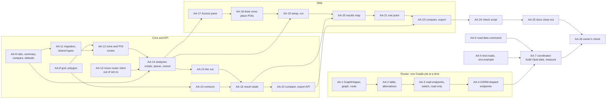

# Architecture: Access analysis

| | |
|---|---|
| BRD | `docs/brd/access-analysis.md`, **version 1.0** (Approved, 25 Nov 2026) |
| Status | **Approved** for building (the owner delegated the design calls to the architect, 25 Nov 2026; every choice below is open to the owner's review) |
| Date | 25 Nov 2026 |
| Checked against | commit `eab9bb5` (branch `refactor/stage-3`) when written; **built** on `feature/access-analysis`, checked against `504fc45` (26 Nov 2026). What was built differently or decided while building is in §12. |
| System architecture | `docs/architecture/system.md` (decisions D14 to D34 come from this document) |
| Tickets | `docs/project/access-analysis-tickets.xlsx` (AA-1 to AA-26, epics EP-15 to EP-20) |

This document says how the BRD's requirements fit the application: what goes where, what is stored, which endpoints and shapes are used, and in what order it is built. It describes design, not code. The words used are the glossary's (`docs/glossary.md`), including the nine terms this BRD proposes.

The owner was asleep and asked for the design to be settled without questions. Every choice is recorded as a decision (D14 to D34 in `docs/architecture/system.md` §10) with the options considered, so it can be reopened.

## 1. Decisions

| # | Question | Options considered | Chosen | Why |
|---|---|---|---|---|
| D14 | Road routing engine | GraphHopper embedded in `router-road`; self-hosted OSRM in Docker; Valhalla in Docker | **GraphHopper 11.1 embedded**, behind a small `RoadRouter` interface; car profile only; speed-up index (contraction hierarchies) on; no turn costs | `docs/router-plan.md` §7.2 and the phase 0 check (§14 there): Apache 2.0, embeddable, Java 17+ (we build for 25). One Java service; the interface lets OSRM or Valhalla go behind it later. No turn costs halves the graph and the import memory; the drive times are free-flow estimates anyway (A3). |
| D15 | Switching road routing on and off; memory | Always on; a setting; a separate service only | **`ROUTER_ROAD` = `auto` (default), `on`, `off` or `only`.** `auto` is on when the road graph folder exists. `only` is the road-only process of A5: same jar, `npm run router:road`, port 3003, 512 MB heap. The graph is memory-mapped when serving. The main router's heap goes from 768 MB to 1 GB. | One jar, no code change between the two ways of running (router-plan §7.2). Memory-mapping keeps the graph in the operating system's file cache, which it can give back under pressure. See §3.4 for the memory budget. |
| D16 | Endpoints and the editor's road requests | Root OSRM paths; OSRM paths under a prefix; change `roads.ts` to a new API | **Our own `POST /v1/road/route` and `POST /v1/road/table`, plus OSRM-shaped `GET /route/v1/driving/…`, `/table/v1/driving/…` and `/nearest/v1/driving/…` at the root of the router**, so `ROUTER_URL=http://localhost:3002` works with no change to `roads.ts`. The code default stays "unset means no road router"; `.env.example` gives `http://localhost:3002`. | FR-13 asks for "no other change". Root paths are exactly what `roads.ts` builds from `ROUTER_URL`. Keeping the code default avoids the fixture e2e suddenly calling a router that happens to be running. |
| D17 | Many drives at once (FR-2) | Repeated single routes in parallel; a one-to-many search written against GraphHopper's internals; a commercial matrix | **Repeated speed-up-index routes, spread over the router's thread pool.** `/v1/road/table` replaces the `/v1/road/bulk` that router-plan §8.1 listed. | Phase 0 found no open-source matrix (router-plan §14). One route on the speed-up index is a few milliseconds; 5,000 × 3 drives on 8 threads is a few seconds, well inside NFR-1. A one-to-many search is faster but ties us to GraphHopper internals. |
| D18 | Road data (FR-3) | Whole Australia into GraphHopper; cut to the Opal area with osmium; cut with GraphHopper | **Geofabrik's Australia extract, cut to the Opal area box with osmium, run from a small Docker image we build from Debian's own `osmium-tool` package; then GraphHopper builds the graph.** One command: `npm run road:data`. Tests use a hand-made `.osm` file of a few streets, in the repository. | The Opal area is a small part of Australia, so the import needs about a quarter of the memory. There is no official osmium image, so we build one from Debian packages rather than trust a stranger's image. Developers' worktrees have no `data/`, so tests need their own small map. |
| D19 | "No road nearby" | No limit; a fixed limit; a setting | **500 m** (`ROUTER_ROAD_SNAP_METRES`). A point further than that from a road gets status `noRoad`. | BRD edge case "no road within a set distance". 500 m keeps parks and beaches in, and the sea out. |
| D20 | Where an analysis runs | In the API process like sim runs; as a job on the router | **In the API process, like sim runs** (`apps/api/src/sim/sim.ts` `drive()`): one at a time, in a queue, resumed when the API starts | The analysis joins two routers and the database; only the API sees all three. Results are written batch by batch, so a restart (the dev API restarts on every save, risk R6) carries on from the last batch instead of starting again. |
| D21 | Public transport times | One journey per request; the bulk endpoint; a simulation run | **`POST /v1/journeys/bulk`**, capacity `off`, `detail: summary`, in batches of 500 queries, on a timetable loaded the way sim runs load one (`timetableKey`, `ensureTimetable`), **cut to a box** round the zone and the points of interest, widened by 15 km | The bulk endpoint runs at about 600 to 700 journeys a second (router-plan §20), so 15,000 take under half a minute. Batches of 500 give progress about every second (NFR-1). A box-cut export is fast to make and load. The sim code is reused, after it is moved out of `sim.ts` into `sim/router-client.ts` and `sim/timetables.ts` (refactor plan §3.2, the part this needs). |
| D22 | Car times | One table per point of interest; one big table; single routes | **One `/v1/road/table` request per point of interest per 1,000 sample points** (sources = sample points, destination = the point of interest) | NFR-1 and the BRD's own mitigation. 1,000 keeps each request a second or two, for progress and cancel. |
| D23 | What "public transport time" counts | Arrival minus the journey's own departure; arrival minus the asked departure | **Arrival minus the asked departure time.** Waiting at home for the first vehicle counts as waiting. | FR-11 says "leaving at the departure time" and lists the wait. The router's journeys leave as late as they can, so its own `durationSecs` leaves the first wait out, which would flatter a service that runs once an hour. |
| D24 | Storage | New tables by a numbered migration; JSON files in `data/` | **Six tables in one migration, numbered `0010_access_analysis.sql`.** The numbers 0002 to 0009 are left for `trustworthy-edits`, whose three migrations are being built on another branch. | §14 standard 5. The runner orders by number and refuses two files with one number (`packages/gtfs/src/migrate.ts`); a gap is fine. A fixed high number means neither branch has to renumber when both merge. |
| D25 | Do zones and points of interest belong to a day? | Per baseline; global | **Global**, reused on any day. An analysis **copies** its zone outline and its points of interest when it is made. | Places do not change with the timetable. Copying means renaming, moving or deleting a zone or point of interest never changes a finished analysis (FR-16). |
| D26 | The sample grid (FR-7) | Cell centres on a grid aligned to the zone's box; a hexagon grid; a grid aligned to round coordinates | **Square grid in local metres, cell centres, from the south-west corner of the zone's bounding box.** Local metres use the same flat-earth factors as `roads.ts` (110,540 m per degree of latitude, 111,320 × cos(latitude) per degree of longitude) about the zone's centre. Each point keeps its grid column and row (`i`, `j`). | Deterministic (NFR-4) and gives exactly 16 points for AC-FR-7.1. The column and row make the lines of equal ratio and the comparison simple. |
| D27 | Lines and bands of equal ratio | d3-contour (pinned 4.0.2); write our own marching squares; marching triangles | **Our own marching triangles** in `packages/core/src/analysis/contours.ts`, over the grid with missing values masked: each grid square whose four corners all have a ratio is split into two triangles; each triangle gives band pieces and line segments by straight-line interpolation; segments are joined into lines | d3-contour cannot leave out a missing value (no service or no road): it treats it as below every threshold, so those places would show as well served, against FR-12. Marching triangles has no ambiguous cases, needs no library and is about 150 lines. |
| D28 | Where the lines are worked out | In the browser; in the API | **In the API**, on request, from the stored results, for the breaks asked for | One place for the map and the GeoJSON export (FR-18). It is a few milliseconds for 5,000 points. |
| D29 | Web app shape | A modal like the vehicle catalogue; a left pane like the simulation | **A left pane, "Access", in a new feature folder `apps/web/src/analysis/`**, with one field in the app store, map layers in `apps/web/src/map/use-analysis-layers.ts`, and one branch in the map's click handler | Matches the Simulation pane (BRD main flow step 1). Keeps `store.ts` and `MapView.tsx` (2,003 lines) from growing more than a few lines. |
| D30 | One sample point's journey (FR-15) | Ask the router again on click; store the legs at run time | **Store each pair's journey summary (its legs, without the stops passed) at run time.** Draw walks and rides as straight lines from end to end, labelled with the line. The car path is asked for from the road router on click. | Stored legs make reopening after a restart work (AC-FR-16.1) and give the same answer every time (NFR-4), even after the scenario is edited. About 500 bytes a pair. The road graph does not change with the timetable, so the car path can be asked again. |
| D31 | When two analyses can be compared (FR-17) | Same zone id; same zone outline and spacing | **Same zone outline (a hash of the copied outline) and same spacing, and the point of interest in both (by its id).** Sample points match by grid column and row. | Points only line up if the outline and spacing are the same. A zone redrawn between runs is a different zone. |
| D32 | Testing without the routers | Skip runs when the routers are down; a fake router | **A small fake router in Node (`apps/api/test/fake-router.mjs`)** answers the journey, timetable, road and health requests with made-up but repeatable answers, so the fixture e2e runs a whole analysis with no Java | BRD §5 allows skipping, but a fake gives real coverage of the job, the batches, cancel and resume on every run. The real routers are checked by the router's own tests and the owner's check (AA-26). |
| D33 | Gradle on this epic | Owner-run only ("How to work" rule 6); allowed for router tickets | **Allowed for AA-1 to AA-4 and AA-7**, one Gradle build on the machine at a time, never beside another heavy job, `.\gradlew --stop` at the end | The owner asked for the epic to be built overnight. |
| D34 | Starting values | | Walk to or from a stop: **800 m**. Longest journey: **120 minutes**. Most changes: **3** (so up to 4 rides). Modes: **all but school buses**. Parking: **5 minutes** (BRD Q2). Traffic factors: **1.0 early morning, 1.4 morning peak, 1.2 middle of the day, 1.4 evening peak, 1.0 evening** (BRD Q1, on `DAY_BANDS`). Spacing: **250 m** (50 to 2,000). Lines at **1, 1.5, 2, 3, 4**. Departure **08:00**. | The BRD's answers to Q1 and Q2; the rest are the router's settled walking rules and a sensible suburb-sized grid. |

## 2. Order of work



- The router track (AA-1 to AA-4) is one developer in a row, because only one Gradle build may run at a time.
- A second developer works the core and API track beside it, then the web track.
- AA-7 and AA-26 need the real `data/` folder, so the coordinator runs them, not a developer in a worktree.
- At most two developers at once (memory).

## 3. Road routing (FR-1, FR-2, FR-3, FR-13, NFR-2, NFR-5)

### 3.1 The `router-road` module

`router-road` depends on `router-core` and GraphHopper; nothing else depends on GraphHopper. Files (package `gtfseditor.router.road`), each under 300 lines:

| File | Holds |
|---|---|
| `RoadRouter.java` | The interface: `boolean available()`, `RoadRoute route(List<LatLon> points, boolean alternatives)`, `RoadTable table(List<LatLon> sources, List<LatLon> destinations)`, `Snapped nearest(LatLon point)`. Thread-safe. |
| `LatLon.java`, `Snapped.java`, `RoadRoute.java`, `RoadTable.java` | Records. `Snapped`: the point on the road, metres from the asked point, or none past the snap limit. `RoadRoute`: status (`OK`, `NO_ROUTE`, `NO_ROAD`), metres, seconds, path as `[lon, lat]` pairs, legs (metres and seconds each), snapped ends, and alternatives. `RoadTable`: seconds and metres as `double[][]` with `NaN` for none, and snap metres for each source and destination. |
| `RoadSettings.java` | Graph folder, snap limit (500 m), threads, table limit. |
| `GraphHopperRoads.java` | The implementation: opens a built graph read-only and memory-mapped, profile `car`, speed-up index on. Snaps each point once with the location index (car-accessible edges only) and checks the snap limit itself. Multi-point routes go through every point in order. Alternatives (only for two points) use GraphHopper's `alternative_route` with the speed-up index, at most 3. A table runs one route per pair on an executor of `threads` threads. |
| `RoadGraphBuilder.java` | Builds a graph folder from an `.osm.pbf` or `.osm` file: car profile from GraphHopper's built-in car custom model, encoded values it needs, no turn costs, the speed-up index for `car`, in-memory storage while building, then written to disk. Writes `road-graph.json` beside it: source file name, its size and date, the box, GraphHopper version, build time. |
| `RoadImport.java` | `main` for the `roadImport` Gradle task: `-ProadArgs="<osm file> <graph folder>"`. Refuses to overwrite a folder that is not a graph folder. |

**Version:** `com.graphhopper:graphhopper-core:11.1` in `gradle/libs.versions.toml` (router-plan §14). If 11.1 will not resolve or will not build under `-Xlint:all -Werror` because of our own code, take the newest 11.x and say so in the ticket notes. GraphHopper brings its own Jackson; Gradle picks the higher version, and the server tests show whether anything broke.

**The `roadImport` task** runs `RoadImport` with `maxHeapSize = "2g"` (the import's peak, estimated; AA-7 measures it). `npm run router:road-import` already points at it.

**Test map:** `router-road/src/test/resources/mini-roads.osm`, a hand-written OpenStreetMap XML file of about 30 nodes near Mayfield, Newcastle: a 4 × 4 grid of residential streets, one primary road across it, one one-way street, one footpath (not drivable), and a separate drivable square with no link to the rest (an island). Tests build it into a JUnit temporary folder in well under a second. No test needs `data/`.

### 3.2 The service

| Setting (environment) | Default | Meaning |
|---|---|---|
| `ROUTER_ROAD` | `auto` | `auto`: road routing on if the graph folder exists, else off with one log line. `on`: refuse to start without the graph. `off`. `only`: road endpoints and health only; every timetable, journey, load and simulation endpoint answers 503 `{"error": "this router runs roads only"}`. |
| `ROUTER_ROAD_GRAPH` | `data/router/road/opal` | The graph folder (relative to where the service runs, like `ROUTER_DATA`). |
| `ROUTER_ROAD_SNAP_METRES` | `500` | D19. |
| `ROUTER_ROAD_TABLE_LIMIT` | `100000` | Most source × destination pairs in one table. |

`Settings.java` gains these four. `RouterServer.java` registers two new classes and adds `road` to health; it is already 723 lines (issue AAI-2), so the new endpoints live in their own files:

- `router-server/.../RoadApi.java`: `/v1/road/route` and `/v1/road/table`.
- `router-server/.../OsrmApi.java`: the three OSRM-shaped endpoints.

`GET /v1/health` gains `"road": {"available": true, "graph": "data/router/road/opal", "builtFrom": "opal.osm.pbf", "builtAt": "…", "mode": "on"}`. `available` is false when off.

**Gradle:** `router-server`'s `run` task heap goes to `1g`. A new task `runRoad` (same main class) sets `ROUTER_ROAD=only`, `ROUTER_PORT=3003` (only when `ROUTER_PORT` is not already set; fixed in AA-7) and a `512m` heap. New npm script `router:road` = `cd services/router && .\gradlew :router-server:runRoad`.

### 3.3 Endpoints and shapes

Coordinates are WGS84. Our own endpoints use `{"lat", "lon"}` objects (as `/v1/journeys` does); the OSRM ones use `lon,lat` as OSRM does. Times are seconds, distances metres, both free-flow.

**`POST /v1/road/route`** (FR-1; router-plan §8.4)

```json
{ "from": {"lat": -32.897, "lon": 151.736}, "to": {"lat": -32.927, "lon": 151.772}, "profile": "car" }
```

```json
{ "status": "ok", "profile": "car", "freeFlow": true, "metres": 5230, "durationSecs": 512,
  "geometry": [[151.7361, -32.8969], [151.7365, -32.8975]],
  "snapMetres": {"from": 12.4, "to": 3.1}, "computeMicros": 2100 }
```

`status` is `ok`, `noRoute` (no way by road) or `noRoad` (an end more than the snap limit from a road; `reason` says which end). `profile` other than `car` is a 400. Optional `"via": [{lat, lon}…]` adds points between.

**`POST /v1/road/table`** (FR-2)

```json
{ "sources": [{"lat": -32.89, "lon": 151.73}], "destinations": [{"lat": -32.927, "lon": 151.772}], "profile": "car" }
```

```json
{ "profile": "car", "freeFlow": true,
  "durationsSecs": [[512.3]], "metres": [[5230.0]],
  "sourceSnapMetres": [12.4], "destinationSnapMetres": [3.1],
  "computeMicros": 41000 }
```

Rows are sources, columns destinations. `null` where there is no way or an end has no road (its snap metres is then `null` too). More pairs than `ROUTER_ROAD_TABLE_LIMIT` is a 400.

**OSRM-shaped endpoints (FR-13).** Exactly what `apps/api/src/routing/roads.ts` sends today. Status 200 with `code: "Ok"`, otherwise 400 with `code` and `message`, as OSRM does (`roads.ts` reads a 400 as "no route", an answer).

| Request | Answer |
|---|---|
| `GET /route/v1/driving/{lon,lat;lon,lat;…}?overview=full&geometries=geojson&steps=false[&alternatives=3]` | `{"code": "Ok", "routes": [{"distance", "duration", "weight", "weight_name": "duration", "geometry": {"type": "LineString", "coordinates": [[lon, lat]…]}, "legs": [{"distance", "duration", "summary": "", "steps": []}]}], "waypoints": [{"location": [lon, lat], "name": "", "distance"}]}`. Up to 500 points. `alternatives` (`true` or a number) is used only for two points; up to 3 routes. `overview=false` leaves out `geometry`. `geometries` other than `geojson`, or `steps=true`, is 400 `InvalidOptions`. No way: 400 `NoRoute`. A point with no road: 400 `NoSegment`. |
| `GET /table/v1/driving/{lon,lat;…}?annotations=distance` | `{"code": "Ok", "distances": [[…]], "sources": [waypoint…], "destinations": [waypoint…]}`. `annotations` may be `duration` (the OSRM default), `distance` or `duration,distance`. Optional `sources` and `destinations` (indexes separated by `;`). `null` where there is no way. Up to 100 points. |
| `GET /nearest/v1/driving/{lon,lat}?number=1` | `{"code": "Ok", "waypoints": [{"location": [lon, lat], "distance", "name": "", "nodes": [0, 0]}]}`. `number` above 1 still gives one. No road within the snap limit: 400 `NoSegment`. |

Bad coordinates anywhere: 400 `InvalidQuery`. In road-only and in normal mode these answer the same.

### 3.4 Memory (NFR-2, A5)

Estimates, measured by AA-7 and written into `docs/router-plan.md` as "Phase 6 findings":

| Item | Estimate |
|---|---|
| Australia extract (already in `data/osm/australia-latest.osm.pbf`, 978 MB, 25 Nov 2026) | download 5 to 15 minutes if fetched again |
| Opal area cut (`data/osm/opal.osm.pbf`) | 150 to 300 MB; 2 to 5 minutes; osmium's memory is small |
| Graph build | 5 to 15 minutes; up to 2 GB heap. Run with the dev servers stopped. |
| Graph on disk (`data/router/road/opal/`) | 300 to 700 MB |
| Serving, in the main router | heap +100 to 200 MB (so 1 GB in all); the graph itself in the file cache, up to its size, given back under pressure |
| Road only (`npm run router:road`) | 512 MB heap plus file cache |

With about 3 GB free beside Postgres, the API and the web app, the main router at 1 GB fits. If AA-7 measures otherwise, the road-only process is the fallback with no code change: start it on 3003 and point `ROUTER_URL` there.

### 3.5 Road data (FR-3)

One command, `npm run road:data`, in `packages/gtfs/src/cli/road-data.ts` (the CLI home in §14), with its pure parts (argument reading, the box, the commands it will run) in `packages/gtfs/src/road/road-data-plan.ts` with a unit test.

1. **Get the extract.** Use `--pbf <file>` if given, else `<data>/osm/australia-latest.osm.pbf` if it exists, else download `https://download.geofabrik.de/australia-oceania/australia-latest.osm.pbf` into it (streamed, with progress).
2. **Cut it.** Build the image `gtfs-editor-osmium` from `services/router/tools/osmium/Dockerfile` if it is missing (`FROM debian:bookworm-slim`, `apt-get install -y --no-install-recommends osmium-tool`). Run `docker run --rm -v <data>/osm:/osm gtfs-editor-osmium osmium extract -b 150.10,-34.75,151.85,-32.70 /osm/australia-latest.osm.pbf -o /osm/opal.osm.pbf --overwrite`. The box is the provided "Opal area" in `sim_areas` (`0001_initial.sql`). Skipped when `--pbf` names a file that is already cut (`--no-cut`).
3. **Build the graph.** Run `services/router/gradlew(.bat) :router-road:roadImport -ProadArgs="<data>/osm/opal.osm.pbf <data>/router/road/opal"`, building into a `opal.new` folder and swapping it in when done, so a failed build leaves the old graph.

Options: `--data <folder>` (default the repository's `data/`, found from the file's own location, as `packs.ts` does), `--pbf`, `--no-cut`, `--dry-run` (prints the three steps and runs none). A worktree passes `--data "C:\Programming Projects\GTFS Editor\data"`.

### 3.6 The editor's road requests (FR-13, NFR-5)

- `roads.ts` does not change. `.env.example` loses the public OSRM line and gains `ROUTER_URL=http://localhost:3002`, explaining that it is the journey router's road side (or the road-only process on 3003).
- A new check, `npm run test:roads` (`apps/api/test/roads.e2e.mjs`), sends the three requests in exactly the form `roads.ts` builds them to `ROUTER_URL`, with Newcastle points, and checks the answers' shape and that a Mayfield to Newcastle city centre drive is 5 to 20 minutes (AC-FR-1.1). It also confirms `ROUTER_URL` names this machine (`localhost`, `127.0.0.1` or `::1`): AC-NFR-5.1.
- The owner's `.env` still names the public OSRM server. **Changing it is the owner's step** (or the coordinator's, with the owner's leave), after AA-7.

## 4. Zones, points of interest and analyses (FR-4 to FR-12, NFR-1, NFR-3, NFR-4)

### 4.1 Pure logic in `packages/core/src/analysis/`

Each file has a `.test.ts` beside it and is exported from `packages/core/src/index.ts`.

| File | Functions |
|---|---|
| `local-metres.ts` | `localFrame(centreLon, centreLat)` → `toMetres([lon, lat])`, `toLonLat([x, y])` with the D26 factors |
| `polygon.ts` | `pointInRing(point, ring)` (even-odd ray test); `ringProblem(ring)` → `null` or a plain-English reason: fewer than 3 corners, more than 200, a side crossing another (any two sides that are not neighbours meet; O(n²) is fine at 200), zero area |
| `grid.ts` | `sampleGrid(ring, spacingM)` → `{points: {i, j, lon, lat}[], columns, rows}` per D26; `gridCount(ring, spacingM)` for the setup screen |
| `limits.ts` | `ANALYSIS_LIMITS` (most sample points 10,000; most points of interest 10; spacing 50 to 2,000 m; corners 3 to 200) and `analysisProblem(counts)` → the NFR-3 message, for example "This makes 10,001 sample points; the most is 10,000. Use a wider spacing or a smaller zone." |
| `defaults.ts` | `DEFAULT_ANALYSIS_SETTINGS` (D34) and the `AnalysisSettings` type's checks |
| `ratio.ts` | `trafficFactorAt(departSecs, factors)` using `bandOf` and `DAY_BANDS` from `time.ts`; `carSecs(driveSecs, factor, parkingSecs)`; `accessRatio(ptSecs, carSecs)`; `pairStatus(pt, drive, settings)` → `ok`, `noService` (no journey, or longer than the longest journey) or `noRoad`; `ptSplit(journey, askedDepart)` → `{ptSecs, walkSecs, waitSecs, rideSecs, rides}` per D23 |
| `summary.ts` | `summarise(statusesAndRatios, breaks)` → count per band, `noService`, `noRoad`, median ratio of the `ok` pairs (FR-20) |
| `contours.ts` | `ratioBands(grid, values, breaks)` → band pieces (polygons in lon, lat) and `ratioLines(...)` → one multi-line per break, per D27. Missing values are `NaN`. |
| `compare.ts` | `compareRatios(a, b)` by `(i, j)` → per point: `better`, `worse`, `same` (change within ±0.05), `gainedService`, `lostService`, `bothNone`, with the change |

### 4.2 Shared types

`packages/core/src/api/analysis.ts` (D9; the folder may not exist yet, as in `trustworthy-edits`): `Zone`, `PointOfInterest`, `AnalysisSettings`, `AnalysisSummary`, `AnalysisDetail`, `AnalysisState`, `PairStatus`, `StoredLeg`, `PointDetail`, `CompareResult`, and the request bodies. Both the API and `apps/web/src/analysis/analysis-api.ts` import them.

### 4.3 Tables: `packages/gtfs/sql/migrations/0010_access_analysis.sql`

All with `create table if not exists`, so a database that somehow has them is not broken.

| Table | Columns |
|---|---|
| `analysis_zones` | `id serial pk`, `name text not null`, `geom geometry(Polygon, 4326) not null`, `created_at`, `updated_at timestamptz default now()` |
| `points_of_interest` | `id serial pk`, `name text not null`, `kind text not null default 'place'`, `source text not null default 'drawn'`, `geom geometry(Point, 4326) not null`, `created_at`, `updated_at` (kind and source: BRD future-proofing) |
| `analyses` | `id serial pk`, `name text not null`, `baseline_id int references baselines on delete set null`, `scenario_id int references scenarios on delete set null`, `scenario_name text`, `zone_id int references analysis_zones on delete set null`, `zone_name text not null`, `zone_geom geometry(Polygon, 4326) not null`, `zone_hash text not null` (md5 of the outline's text), `settings jsonb not null`, `timetable_id text`, `timetable_version text`, `state text not null default 'queued'` (`queued`, `preparing`, `running`, `done`, `failed`, `cancelled`), `progress jsonb not null default '{}'`, `error text`, `sample_count int not null`, `created_at`, `started_at`, `finished_at` |
| `analysis_pois` | `analysis_id → analyses on delete cascade`, `seq int`, `poi_id int references points_of_interest on delete set null`, `name text`, `geom geometry(Point, 4326)`; pk `(analysis_id, seq)` |
| `analysis_points` | `analysis_id → analyses on delete cascade`, `seq int`, `i int`, `j int`, `lon float8`, `lat float8`; pk `(analysis_id, seq)` |
| `analysis_results` | `analysis_id → analyses on delete cascade`, `point_seq int`, `poi_seq int`, `status text not null` (`pending`, `ok`, `noService`, `noRoad`), `drive_checked boolean not null default false`, `pt_secs int`, `walk_secs int`, `wait_secs int`, `ride_secs int`, `rides int`, `legs jsonb`, `drive_secs real`, `drive_metres real`, `car_secs real`, `ratio real`; pk `(analysis_id, poi_seq, point_seq)` |

When the run starts it inserts one `pending` row per pair (if none yet). The drives step fills the drive columns and sets `drive_checked` (a pair with no road keeps null drive columns); the journeys step fills the rest and sets the final `status`. A pair is finished when its `status` is not `pending`, so a resumed run picks up exactly where it stopped.

Review tier: Light. The migration only adds tables; nothing is changed or deleted.

### 4.4 API: `apps/api/src/analysis/`

| File | Holds |
|---|---|
| `places-routes.ts` | Zones and points of interest: `GET/POST /api/analysis/zones`, `PATCH/DELETE /api/analysis/zones/:id`; `GET/POST /api/analysis/pois`, `PATCH/DELETE /api/analysis/pois/:id`. A zone body is `{name, ring: [[lon, lat]…]}`; `ringProblem` refuses a bad one with 400 and its reason. A point of interest is `{name, lon, lat, kind?}`; PATCH takes `name` and/or `lon, lat` (moving). |
| `routes.ts` | `GET /api/analyses?baseline=`, `POST /api/analyses`, `GET /api/analyses/:id`, `POST /api/analyses/:id/cancel`, `DELETE /api/analyses/:id` |
| `create.ts` | Checks the body (settings in range, 1 to 10 points of interest, the NFR-3 count), checks both routers answer (`/v1/health` on `ROUTER_SERVICE_URL`; `/v1/health` with `road.available` on `ROUTER_URL`), copies the zone and points of interest, lays and stores the sample points, and queues the run. A router that is down is a 503 naming it, and nothing is stored. |
| `runner.ts` | The queue and `driveAnalysis(id)` (D20): one at a time; on API start, every `queued`, `preparing` or `running` analysis is driven again. |
| `run-drives.ts` | The car side (D22): pending rows per point of interest, `/v1/road/table` in batches of 1,000, the traffic factor and parking from `ratio.ts`. |
| `run-journeys.ts` | The public transport side (D21): batches of 500 pairs to `/v1/journeys/bulk`, NDJSON read line by line, `ptSplit`, `pairStatus`, ratio, one multi-row update per batch. |
| `journeys-client.ts` | Streams a bulk request and yields each line, typed. |
| `road-client.ts` | `/v1/road/table` and `/v1/road/route` on `ROUTER_URL`, typed. "Not running" errors name `ROUTER_URL`. |
| `results-routes.ts` | Reads for the map (§5.1). |
| `export-routes.ts` | Exports and compare (§5.3). |

Every file under 300 lines; no `any`.

**The run, step by step** (states in brackets):

1. `[preparing]` The timetable: `timetableKey(sql, baselineId, scenario, box)` with `box` = the extent of the zone and the points of interest, widened by 15 km; `ensureTimetable(key, …)`. Progress `{stage: 'timetable', secs}`. The key's id and version are stored. If the scenario is gone, the run fails with that message.
2. `[running]` Drives: progress `{stage: 'drives', done, total}`.
3. Journeys: one query per pending pair: `from` the sample point, `to` the point of interest, `depart` = settings.departSecs, with `maxWalkMetres`, `maxRides = maxChanges + 1`, `avoid` = the modes not allowed, `capacity: {mode: 'off'}`, `detail: 'summary'`. Each answer line gives `pt` for its pair. Progress `{stage: 'journeys', done, total}`.
4. `[done]` `finished_at`; progress `{}`.

Cancel sets a flag the runner checks between batches (at most a couple of seconds); the run then deletes its results and becomes `cancelled`. Any error becomes `failed` with the message, and its results are deleted. Errors from the router keep the router's words (BRD edge cases).

**Sameness (NFR-4).** The grid, the box and the timetable version are fixed by the inputs; `off` journeys and drive times do not depend on order or threads. The e2e test runs one analysis twice and compares every result row.

**Speed (NFR-1).** 15,000 journeys at 600 a second is 25 s; 15,000 drives on 8 threads is under 10 s; exporting and loading a box-cut day is the slow part the first time (tens of seconds) and free after. AA-26 times a 5,000 × 3 run.

### 4.5 Moving the router client out of `sim.ts`

`apps/api/src/sim/sim.ts` is 1,681 lines and refactor plan §3.2 (splitting it) is not ticketed. The analysis needs `router()`, `ROUTER_DOWN`, `timetableKey`, `ensureTimetable` and the water file. AA-13 moves them, unchanged, into `apps/api/src/sim/router-client.ts` (the call and the "not running" words) and `apps/api/src/sim/timetables.ts` (the key, the water file, loading), the names the planned layout already gives. `sim.ts` imports them back. Nothing else in `sim.ts` changes. The analysis imports these two top-level files of `sim/`, which the folder rules allow. The moved code keeps its existing `any` (T-18 removes those); the analysis does not use `router()`'s untyped body, it has its own typed clients.

## 5. Results (FR-14 to FR-20)

### 5.1 Reads

| Route | Returns |
|---|---|
| `GET /api/analyses/:id` | The analysis: settings, state, progress, error, zone (GeoJSON), points of interest, and per point of interest the summary of FR-20 for its default breaks |
| `GET /api/analyses/:id/points?poi=<seq>` | GeoJSON points: `seq`, `status`, `ptMins`, `carMins`, `ratio` |
| `GET /api/analyses/:id/lines?poi=<seq>&breaks=1,1.5,2,3,4` | `{bands, lines, summary}`: band pieces as one MultiPolygon per band with `from`, `to`; lines as one MultiLineString per break with `ratio`; the summary for these breaks. Breaks: 1 to 8 values, rising, each 0.1 to 20. |
| `GET /api/analyses/:id/points/:seq?poi=<seq>` | One pair (FR-15): times, ratio, the split, the stored legs, and the car path from `/v1/road/route` (or `carPath: null` with a message if the road router is not answering) |

### 5.2 Web app: `apps/web/src/analysis/`

| File | Holds |
|---|---|
| `analysis-api.ts` | Fetch calls, using `getJson` from `shared/api-client.ts` and the shared types |
| `analysis-state.ts` | The `AnalysisView` type and small helpers to change it. The app store gets one field, `analysis: AnalysisView`, and `LeftPane` gains `'analysis'`. `AnalysisView`: `screen` (`list`, `setup`, `results`, `compare`), `drawing` (corners so far, or null), `placingPoi` (a name waiting for a click, or null), `movingPoiId`, the setup choices, `openId`, `poiSeq`, `breaks`, `pointSeq`, `compareWith`. |
| `analysis-map.ts` | `analysisMapClick(lon, lat)`: adds a corner, drops a pin or opens a pin's name box (since D36; placed and moved by dragging, not a click), or picks the nearest sample point (within 12 px). Returns true when it used the click. `MapView.tsx` calls it first in its click handler, as it does `addClosurePoint`. |
| `AnalysisPanel.tsx` | The pane: the list of analyses for the day (name, timetable, state, progress bar, Open, Delete), "New analysis", and the screen in use |
| `setup/AnalysisSetup.tsx`, `setup/ZonePicker.tsx`, `setup/PoiPicker.tsx`, `setup/AnalysisSettingsForm.tsx` | One screen (FR-6): zone (pick, draw, rename, delete), points of interest (pick several, place, move, rename, delete), timetable (the published day or one of its scenarios, defaulting to the one open), departure, spacing, the live count line "312 sample points, 2 points of interest: 624 public transport journeys and 624 drives" (from `gridCount`), public transport limits (FR-8), car settings (FR-9), and Run. A refused count shows the NFR-3 message and disables Run. |
| `results/AnalysisResults.tsx` | The point of interest list, breaks ("Lines at"), summary table (FR-20), export links, "Compare with…" |
| `results/AnalysisLegend.tsx` | On the map: band colours with their ranges, no service, no road, the settings in one line ("Published day · 08:00 · 250 m · walk 800 m · parking 5 min · traffic 1.4"), and "Driving times © OpenStreetMap contributors (ODbL)" (FR-19, A4) |
| `results/PointDetail.tsx` | One sample point (FR-15): the legs as a list (walk, wait, ride with the line, change), both times, the ratio, and a bar of walk, wait and ride |
| `results/CompareView.tsx` | Pick the other analysis (only those that can be compared, D31), the counts better and worse, and the key |
| `analysis-colours.ts` | The colours (below), used by the layers and the legend |
| `analysis.css` | The pane's styles |

**Map layers:** `apps/web/src/map/use-analysis-layers.ts` (the zone being drawn, saved zones in the setup, the points of interest, the zone outline) and `apps/web/src/map/use-analysis-result-layers.ts` (bands, lines with their ratio as labels, sample points by status, the chosen point's journey and car path, the comparison). `MapView.tsx` calls both hooks. Each source carries `attribution: '© OpenStreetMap contributors'` where road results are shown, so the map's own credit line shows it too.

**Drawing a zone:** "Draw a zone" puts the map in drawing mode; each click adds a corner; clicking the first corner, or "Finish", closes it; Escape or "Cancel" stops. On closing, `ringProblem` runs in the browser and a crossing outline is refused with the message (AC-FR-4.2), keeping the corners so the user can undo the last one ("Undo corner"). Then it asks for a name and saves.

**Points of interest:** "Add a point of interest" asks for a name, then the next click places it. "Move" on a listed point means the next click is its new place.

**Colours** (fixed, readable on both basemaps): bands, well served to poorly served, for the default six: `#2c7bb6`, `#abd9e9`, `#ffffbf`, `#fdae61`, `#f46d43`, `#d73027`, at 55% opacity; with other breaks the scale is spread over the same colours. Lines dark grey `#333333`, 1.5 px, labelled. No service: grey `#7f7f7f` points with a white ring. No road: `#cccccc` hollow points. Comparison: better `#1a9641`/`#a6d96a`, worse `#fdae61`/`#d7191c` (changes of 0.25 and 1), gained service a green ring, lost service a red ring.

### 5.3 Saving, comparing and export (FR-16, FR-17, FR-18)

- **Saving** is the tables of §4.3. The list survives restarts (AC-FR-16.1).
- **Compare:** `GET /api/analyses/compare?a=<id>&b=<id>&poi=<poiId>` → 409 with the reason if D31 is not met; otherwise GeoJSON points with `change` (b − a), `kind` (from `compareRatios`), and counts.
- **Export** (each a download with a file name):
  - `GET /api/analyses/:id/export/results.csv`: one row per sample point and point of interest: `point, lat, lon, poi, poi_name, status, pt_mins, walk_mins, wait_mins, ride_mins, rides, drive_mins_free_flow, drive_km, traffic_factor, parking_mins, car_mins, ratio` (AC-FR-18.1).
  - `GET /api/analyses/:id/export/points.geojson`: the same rows as point features.
  - `GET /api/analyses/:id/export/lines.geojson?poi=&breaks=`: the lines of equal ratio for one point of interest.

## 6. Files to add or change

```
services/router/
  gradle/libs.versions.toml                     CHANGE  graphhopper 11.1
  router-road/build.gradle.kts                  CHANGE  graphhopper-core; roadImport runs RoadImport (2g)
  router-road/src/main/java/gtfseditor/router/road/
    RoadRouter.java, LatLon.java, Snapped.java, RoadRoute.java, RoadTable.java,
    RoadSettings.java, GraphHopperRoads.java, RoadGraphBuilder.java, RoadImport.java      NEW
  router-road/src/test/resources/mini-roads.osm NEW
  router-road/src/test/java/.../GraphHopperRoadsTest.java, RoadTableTest.java             NEW
  router-server/build.gradle.kts                CHANGE  run heap 1g; runRoad task
  router-server/src/main/java/gtfseditor/router/server/
    RoadApi.java, OsrmApi.java                  NEW
    Settings.java, RouterServer.java            CHANGE  road settings; register; health; road-only mode
  router-server/src/test/java/.../RoadApiTest.java, OsrmApiTest.java                       NEW
  tools/osmium/Dockerfile                       NEW
  README.md                                     CHANGE  road section (AA-25)
packages/core/src/
  analysis/local-metres.ts, polygon.ts, grid.ts, limits.ts, defaults.ts,
           ratio.ts, summary.ts, contours.ts, compare.ts (+ .test.ts each)                NEW
  api/analysis.ts                               NEW
  index.ts                                      CHANGE  exports
packages/gtfs/
  sql/migrations/0010_access_analysis.sql       NEW
  src/cli/road-data.ts                          NEW
  src/road/road-data-plan.ts (+ .test.ts)       NEW
apps/api/
  src/analysis/places-routes.ts, routes.ts, create.ts, runner.ts, run-drives.ts,
               run-journeys.ts, journeys-client.ts, road-client.ts,
               results-routes.ts, export-routes.ts                                        NEW
  src/sim/router-client.ts, timetables.ts       NEW (moved out of sim.ts)
  src/sim/sim.ts                                CHANGE  imports them back
  src/server.ts                                 CHANGE  registers the analysis routes, resumes runs
  test/analysis.e2e.mjs, fake-router.mjs        NEW
  test/run-e2e-fixture.mjs                      CHANGE  also runs analysis.e2e.mjs with the fake router
  test/roads.e2e.mjs                            NEW     (npm run test:roads)
apps/web/
  src/analysis/ (files in §5.2)                 NEW
  src/map/use-analysis-layers.ts, use-analysis-result-layers.ts   NEW
  src/map/MapView.tsx                           CHANGE  two hook calls, one click branch
  src/app/store.ts, LeftRail.tsx                CHANGE  analysis field, the Access pane
  vite.config.ts                                CHANGE  WEB_PORT and API_TARGET from the environment (AA-24)
  test/access-check.mjs, run-access-check.mjs   NEW
package.json                                    CHANGE  road:data, router:road, test:roads, test:access
.env.example                                    CHANGE  ROUTER_URL
docs/pr/access-analysis/*.png                   NEW     (AA-26 screenshots)
```

## 7. Requirements to design

| Requirement | Design | Tickets |
|---|---|---|
| FR-1 | §3.1, §3.3 `/v1/road/route` | AA-1, AA-3 |
| FR-2 | D17, §3.3 `/v1/road/table` | AA-2, AA-3 |
| FR-3 | D18, §3.5 | AA-1 (`roadImport`), AA-5, AA-7 |
| FR-13 | D16, §3.3, §3.6 | AA-4, AA-6, AA-7 |
| FR-4 | D25, §4.3, §4.4 `places-routes.ts`, §5.2 drawing | AA-8, AA-11, AA-12, AA-18 |
| FR-5 | same | AA-12, AA-18 |
| FR-6 | §5.2 setup screen, `gridCount` | AA-19 |
| FR-7 | D26, `grid.ts` | AA-8, AA-14 |
| FR-8 | D34, §4.4 step 3 | AA-15, AA-19 |
| FR-9 | D34, `ratio.ts` | AA-9, AA-15, AA-19 |
| FR-10 | D20, runner, cancel, progress | AA-14, AA-15, AA-19 |
| FR-11 | D23, `ratio.ts` | AA-9, AA-15 |
| FR-12 | `pairStatus`, D27 masking | AA-9, AA-10, AA-20 |
| FR-14 | D27, D28, §5.1 lines, §5.2 layers | AA-10, AA-16, AA-20 |
| FR-15 | D30, §5.1, `PointDetail` | AA-15, AA-16, AA-21 |
| FR-16 | §4.3, list | AA-11, AA-14, AA-17, AA-22, AA-23 |
| FR-17 | D31, `compare.ts`, §5.3 | AA-9, AA-22, AA-23 |
| FR-18 | §5.3 export | AA-22, AA-23 |
| FR-19 | `AnalysisLegend`, attribution | AA-20 |
| FR-20 | `summary.ts`, §5.1 | AA-9, AA-16, AA-20 |
| NFR-1 | D21, D22, batches | AA-15, AA-26 |
| NFR-2 | D15, §3.4 | AA-3, AA-7 |
| NFR-3 | `limits.ts`, `create.ts`, setup screen | AA-8, AA-14, AA-19 |
| NFR-4 | D26, §4.4 sameness | AA-15 |
| NFR-5 | D16, §3.6; see AAI-5 | AA-6, AA-7 |
| NFR-6 | Glossary words; every UI string reviewed | every web ticket |

## 8. Testing seams

- **Pure functions** in `packages/core/src/analysis/`: the grid (AC-FR-7.1: a 1 km square at 250 m gives 16 points), the outline check (AC-FR-4.2), the ratio and traffic factor (AC-FR-9.1, AC-FR-11.1), the status (AC-FR-12.1), the summary (AC-FR-20.1: counts add up), contours (a ramp gives straight lines at the right places; a missing corner leaves its triangles out), comparison (AC-FR-17.1).
- **Java:** `router-road` tests on `mini-roads.osm` (a route along the streets; the one-way street is driven one way only; the footpath is not used; the island gives `NO_ROUTE`; a point 600 m out gives `NO_ROAD`; a 3 × 2 table gives 6 answers and agrees with single routes); server tests for `/v1/road/*` and each OSRM-shaped answer in the exact form `roads.ts` reads, road-only mode answering 503 on `/v1/journeys`, and health. `RouterServerTest` keeps passing.
- **API (fixture e2e):** `apps/api/test/analysis.e2e.mjs`, run by `npm run test:e2e:fixture` against the fake router (D32): zones and points of interest made, renamed, moved and deleted; a crossing zone refused; 10,001 points refused; a run with progress and done; results' shape; cancel; same results twice (NFR-4); 503 naming the router that is down; reads, compare and export.
- **Roads against the real router:** `npm run test:roads` (AA-6, run in AA-7).
- **UI and the owner's check:** `npm run test:access` (`apps/web/test/run-access-check.mjs`) brings up a throwaway stack and drives the browser over the DevTools protocol, as `test:ui` does; it writes screenshots. AA-24 proves it against the fixture and the fake router; AA-26 runs it on real data.

### The owner's check (AA-26)

`run-access-check.mjs` sets up, then `access-check.mjs` drives:

| Part | Port or name |
|---|---|
| Database | `gtfs_aa_check`, the owner's day imported with `FEED_PATH` pointing at the cached feed in `data/feeds/` and the date read (read-only) from `gtfs_editor`'s `baselines`; packs into a temporary folder; dropped at the end unless `--keep` |
| API | 3111, `API_PUBLIC_URL=http://localhost:3111`, `ROUTER_SERVICE_URL=http://localhost:3112`, `ROUTER_URL=http://localhost:3112` |
| Router (timetables and roads) | 3112, `ROUTER_DATA` a temporary folder, `ROUTER_ROAD_GRAPH` the absolute path of `data/router/road/opal` |
| Web | 5183, `API_TARGET=http://127.0.0.1:3111` |
| Browser | headless Edge or Chrome, 1600 × 900 |

The steps, with approximate places:

1. Open the Access pane. Draw the zone "Mayfield" by clicking four corners: (-32.884, 151.722), (-32.884, 151.752), (-32.909, 151.752), (-32.909, 151.722) (latitude, longitude), and close it. About 2.8 × 2.8 km, so about 120 sample points at 250 m.
2. Place "Newcastle city centre" at (-32.9270, 151.7720) (Civic, Hunter Street) and "Westfield Kotara" at (-32.9410, 151.6940).
3. Published day, 08:00, 250 m, the starting settings. Check the count line. Run, and wait for done.
4. Screenshots: `01-zone.png`, `02-pois.png`, `03-setup.png`, `04-running.png`, `05-city-centre.png`, `06-kotara.png` (after switching), `07-point-detail.png` (a sample point near Mayfield station), `08-legend.png` (cropped).
5. Check: the legend, the settings line and the OpenStreetMap credit are visible; band counts add up to the sample points; the Mayfield to city drive is 5 to 20 minutes.
6. `--speed`: through the API only, a zone of about 7 × 7 km over Newcastle at 100 m (about 4,900 points) and three points of interest; prints the time (NFR-1: under 5 minutes).

Screenshots go to `docs/pr/access-analysis/` and are committed on the AA-26 branch so the pull request can show them.

## 9. Issues and discrepancies

| # | Found | Who acts | State |
|---|---|---|---|
| AAI-1 | `apps/api/src/sim/sim.ts` (1,681 lines) holds the router client and timetable loading that the analysis needs; refactor plan §3.2 (split `sim.ts`) is not ticketed (`docs/project/refactor-tickets.xlsx`, Coverage: "3.2 sim.ts not planned yet"). Design: AA-13 moves just those two parts, to the names the planned layout already uses. The rest of §3.2 stays unticketed. | Project manager (done: AA-13) | Decided |
| AAI-2 | Java files over 300 lines: `RouterServer.java` 723, `Simulations.java` 677, `JourneyApi.java` 659, `Timetables.java` 374. §14's short-file standard is written for the TypeScript side; T-19's file length check covers only `.ts`, `.tsx`, `.mjs` and `.css` under `apps/` and `packages/`. New road code goes in new files and adds only a few lines to `RouterServer.java`. Should the 300-line rule and its check cover `services/router`? | Owner | Open |
| AAI-3 | `docs/router-plan.md` §8.1 lists `POST /v1/road/bulk` (streamed). D17 replaces it with `POST /v1/road/table`. §7.3's "memory-mapped for serving" stands; §7.5's OSRM endpoints and "a routing server that can be told a road is closed" (A7) are as the BRD says. Update router-plan §8.1 and add "Phase 6 findings" in AA-7 and AA-25. | Developer (docs, AA-7, AA-25) | Resolved 26 Nov 2026: router-plan §8.1 updated and §21 added (AA-7); §7 marked as built (AA-25) |
| AAI-4 | Migration numbers: `trustworthy-edits` plans three migrations "numbered whatever is next" on another branch. D24 reserves `0010` for this work and leaves 0002 to 0009 to that one. If `trustworthy-edits` needs more than eight, it skips 0010. | Coordinator (keep to it when merging) | Decided |
| AAI-5 | NFR-5 says "no coordinates are sent outside the machine once FR-13 is built". The basemap tiles still come from OpenFreeMap (`apps/web/src/app/theme.ts`), and tile addresses say which part of the map is being looked at, though not any sample point or stop. The design reads NFR-5 as "no routing request leaves the machine", which is what the BRD's success line and AC-NFR-5.1 describe. If the owner means tiles too, a self-hosted basemap is a separate piece of work. | Owner, then BA | Open |
| AAI-6 | `docs/architecture/system.md` §3 and §8 and decision D5 say road paths come from an outside OSRM server. After FR-13 they come from the journey router. D5 is marked superseded by D16 now; the context table and diagram are updated at close-out (AA-25), when it is built. | Developer (docs, AA-25) | Resolved 26 Nov 2026: system.md §3, §4, §5.1, §6, §8, §9 updated |
| AAI-7 | BRD I-1: `PLAN.md` lists "a self-hosted routing server" as remaining work; FR-13 does it. Fixed at close-out (AA-25). "A routing server that can be told a road is closed" stays (A7). | Developer (docs, AA-25) | Resolved 26 Nov 2026: struck from `PLAN.md`; BRD I-1 closed |
| AAI-8 | "How to work" rule 6 says developers don't run Gradle. D33 allows it for the router tickets of this epic, as the owner asked. | Recorded in the tickets' "How to work" sheet | Decided |
| AAI-9 | The BRD's edge cases use "no road" for a sample point with no road nearby, but the glossary list does not include it. It is a status beside "no service". Added to the "No service" entry as a related word; the BA may want its own entry. | BA | Resolved 26 Nov 2026 at close-out (AA-25): "No road" has its own glossary entry, with "Comparison" and its six words; the BA may still revise them |
| AAI-10 | `create.ts` runs `gridCount` before any size guard, so a very large zone at 50 m spacing is slow to refuse (AA-14). The setup screen guards itself with an area-based "About" count for huge boxes (AA-19). | Project manager (a small ticket: check columns × rows before counting) | Open |
| AAI-11 | The results CSV does not guard text cells (analysis, zone and point of interest names) against formula injection when opened in a spreadsheet (AA-22). | Project manager (a small ticket) | Open |
| AAI-12 | The map's hover tooltip still shows while a zone is being drawn (AA-18). | Project manager (a small ticket) | Open |
| AAI-13 | `apps/web/src/app/store.ts` is 335 lines after the `analysis` field (AA-17), over the 300-line standard. | Project manager (refactor stage 5) | Open |

## 10. Risks and open questions

| Risk | Effect | What to do |
|---|---|---|
| GraphHopper 11.1 and our build (`-Werror`, Jackson versions) | AA-1 takes longer | Newest 11.x is allowed; the interface keeps the rest of the router unaware of GraphHopper |
| The graph build needs more than 2 GB | AA-7 fails on the dev machine | Stop the dev servers; raise the task's heap to 3 GB; or cut a smaller box (Newcastle only) for the owner's check |
| Alternatives with the speed-up index | `routedAround` gets one route, not up to three | It already copes: it falls back to its ring search |
| Memory with everything running | The machine swaps | Road-only process (A5); measured in AA-7 |
| A box-cut timetable drops a journey that leaves the box | A few pairs show no service wrongly | 15 km margin; the BRD's success check is by eye |
| Short trips near a point of interest give noisy ratios | Odd colours right beside it | Shown as is (BRD risk); a later version may set a floor |
| The real import for the owner's check is slow or heavy | AA-26 cannot finish overnight | `run-access-check.mjs --use-running` drives a stack the owner starts in the morning instead |
| Timetables held | An analysis's box-cut timetable can push a sim timetable out (`ROUTER_MAX_TIMETABLES` = 2) | It is reloaded when next needed; say so in the README |

Open questions: AAI-2 and AAI-5 for the owner. BRD Q1 and Q2 are taken as stated (D34).

## 11. Future direction

- Other measures on the same grid (journey time alone, number of changes): `contours.ts` takes any value per point; only the ratio is mapped now.
- Points of interest from a dataset: `kind` and `source` are there.
- "Avoid a closed area" in the road router (A7): GraphHopper's custom model can do it, in the slower flexible mode (router-plan §14); `RoadRouter` would gain an `avoid` argument and `routedAround` could become one request.
- Walking on the street network: the same graph with a foot profile (router-plan §7.5).

## 12. As built (26 Nov 2026)

Every ticket AA-1 to AA-24 is merged into `feature/access-analysis`. The design above stands; these are the choices the developers made inside it, and the places where the code differs from the tables above. The file lists are kept current in `docs/codebase-map.md`.

**Road router (§3).**
- The graph leaves out footways, cycleways, paths, steps and the like. In the real data a point is not placed on an island of road with fewer than 200 links (GraphHopper's minimum network size; 0 in the tests). Each point is placed on the road once, then the drive is planned on the speed-up index.
- Many drives and other routes have their own classes in `router-road`: `GraphHopperTable` (one query graph, the thread pool) and `GraphHopperAlternatives` (other routes work with the speed-up index on 11.1). The JSON of the road endpoints is in `RoadJson.java`, and the OSRM request's parts in `OsrmRequest.java`.
- The OSRM-shaped `route` takes a missing `geometries` as `geojson`, gives up to 2 other routes (3 in all) and only where GraphHopper finds ones different enough, and refuses more than 500 points (`TooBig`). Jetty's request header size is raised to 32 KB for a 500-point address.
- AA-7 measured everything (router-plan §21): the road-only process is not needed; the main router with roads stays under 800 MB.

**API (§4.4).** Besides the files listed: `create-body.ts` reads the create body (settings left out take D34's values); `results-read.ts` reads what the result routes need and rebuilds the grid; `compare-read.ts` says which analyses can be compared (the list carries `comparableWith`); `export-rows.ts` builds the export rows. The compare and export routes are both in `export-routes.ts`.
- **Ride metres** in a stored leg are the straight line from boarding to alighting.
- A journey longer than the longest journey allowed is `noService`, but its time, split and legs are kept, so the sample point can still show it; its ratio is null.
- `PointDetail` keeps the core names: `pt` (the split), `poiSeq`, `carPathMessage`.
- The open ends of the outer bands are `null` in JSON (they are infinite in `packages/core`); breaks are checked before the lines are worked out.
- In the results CSV the `poi` column is the analysis's own point of interest number (`seq`); the comparison's `poi` is the saved point of interest's id, since two analyses number theirs separately.
- A zone's PATCH renames it (and, since D37, takes a new outline as `ring`; see "Map editor" below).

**Pure logic (§4.1).** `contours.ts` joins its segments with `contour-lines.ts`. The band type is `RatioBandPieces` (`RatioBand` is the summary's). `ContourGrid` takes its origin as the south-west corner of the zone's box plus half a spacing.

**Web app (§5.2).**
- The list of the day's analyses, and the saved zones and points of interest, are kept in a store local to the feature (`analysis-api.ts`), not the app store, which gains only the `analysis` field (D29 kept). The rail's Access button shows a badge while one is running. Accepted by the architect (coordinator) in AA-17.
- The open analysis's results, the picked sample point and the comparison each have a small store of their own: `analysis-results.ts`, `point-detail.ts`, `analysis-compare.ts`. `point-journey.ts` turns the stored legs into lines for the map; waits are worked out from the clock times, as none is stored.
- The setup has more parts than listed: `NameForm.tsx`, `PlaceRow.tsx`, and the pure `setup-form.ts` and `setup-choices.ts`. The results' words are in `results/results-text.ts`, `point-detail-text.ts` and `compare-text.ts`, with `point-detail.css` and `compare-export.css` beside them.
- Progress comes from the list, fetched every 2 s while anything is waiting or running, not from each analysis's detail (accepted by the architect in AA-19). For a zone whose box is too big to count quickly, the count line gives an "About" figure from the area.
- `analysisMapClick(lon, lat, pixelsTo)`: the map passes a function that measures screen pixels to a place, used to close the outline on its first corner and to pick the nearest sample point within 12 px.
- The map layers are four hooks: `map/use-analysis-layers.ts` (places) and `use-analysis-result-layers.ts` (results), which `MapView.tsx` calls, and `use-analysis-point-layers.ts` (the picked point) and `use-analysis-compare-layers.ts` (the comparison), which the results hook calls. Their sources and layers are named `aa-…`. The road results' sources carry the OpenStreetMap credit, so it shows only while results are on the map. Opening an analysis moves the map to its zone.
- **Comparison direction:** the open analysis is `a` and the one picked under "Compare with…" is `b`, so the change is the other analysis's ratio less the open one's; a fall is "Better" (§5.3, `compareRatios`).
- `vite.config.ts` reads `WEB_PORT` and `API_TARGET`, so a check can run a private web app beside the owner's.

**Tests (§8).** The fixture e2e is split into `analysis.e2e.mjs` and the suites it runs (`analysis-runs`, `analysis-progress`, `analysis-pairs`, `analysis-results`, `analysis-compare`), with `analysis-e2e-client.mjs`, `analysis-results-lines.mjs` and `analysis-export-checks.mjs` as helpers; the fixture run uses the fake router as both `ROUTER_SERVICE_URL` and `ROUTER_URL` (it answers no OSRM-shaped request, so `roads.ts` falls back as with no road router), and starts a second API to check that runs carry on. `npm run test:access` is eight files in `apps/web/test/`: `run-access-check.mjs`, `access-stack.mjs`, `access-check.mjs`, `access-results-checks.mjs`, `access-browser.mjs`, `access-map.mjs`, `access-places.mjs` and `access-speed.mjs`. With `--fixture --speed`, 4,900 sample points to 3 points of interest ran in 5.4 s on the fake router. There is no test hook in the app.

**Map editor (26 Nov 2026, D35 to D37, branch `feature/aa-map-editor`).** The owner found typing a name in the side panel before clicking the map awkward, and asked for light, dark and satellite maps. Built:
- **Basemap picker** for the whole app (D35): `map/basemaps.ts` (the four, the default that follows the theme, the satellite style built in code, which map colours go on each), `map/basemap-choice.ts` (the choice, kept in `localStorage`), `map/BasemapPicker.tsx` (a button beside the zoom buttons). `App.tsx` keys `MapView` by theme and basemap, so a change rebuilds the map by the same path as a theme change, and every layer is added again; `MAP_PALETTE` lost its `basemap` field.
- **Tool bar and name box** (D36): `analysis/AnalysisMapEditor.tsx`, which `MapView` renders once the map is made, and `analysis/map-editor/` (`AnalysisToolbar.tsx`, `MapNameBox.tsx`, `name-box-place.ts`, `map-actions.ts`, `use-map-editing.ts`, `use-tool-keys.ts`, `map-editor.css`). The tools' state is the view's `work` field (`analysis/map-work.ts`), which replaces `drawing`, `drawingClosed`, `drawingProblem`, `placingPoi` and `movingPoiId`. `setup/ZoneDrawing.tsx` and the side panel's "Draw a zone", "Add a point of interest" and "Move" are gone. The name box sits above the middle of the top of the zone's box, or above the pin, kept inside the map (below its place when there is no room). A click on a saved pin with no tool opens its name box to rename it. While a tool is in use the map's tooltip is hidden, and the map fits places below the tool bar.
- **Dragging** (D37): `analysis/zone-edit.ts` (handles, which one a press lands on, the outline after a drag), `analysis/map-drag.ts` (what is being dragged, and the pointer while drawing; a store of its own because it changes with every move). A press on a pin or a handle stops the map panning for that press; anywhere else the map pans as usual. The places are drawn by `map/use-analysis-layers.ts` from `map/analysis-place-features.ts`. An outline that crosses itself is refused in the browser with `ringProblem`'s words and snaps back.
- **API**: `places-routes.ts` checks a PATCH `ring` with `ringOf`, the same rules as a new zone; tested in `apps/api/test/analysis-zone-reshape.e2e.mjs`, including that an analysis keeps its copy.
- **Check**: `npm run test:access -- --fixture` draws and names with the tools and switches basemaps (`apps/web/test/access-editor.mjs`, `dragPlace` in `access-map.mjs`), saving `09-basemap-streets.png` to `14-reshape-zone.png`. `run-access-check.mjs` finds Vite as Node does, so it runs from a git worktree too.
- Rough edges left: the hint beside the tool bar (when no tool is in use it says what can be dragged) can cover the top of the map; pressing a zone handle without moving it passes the click on to the map; there is no undo for a drag (drag it back).

## 13. Change log

| Version | Date | Change | BRD version |
|---|---|---|---|
| 1.0 | 25 Nov 2026 | First version; D14 to D34; approved for building under the owner's delegation | 1.0 |
| 1.2 | 26 Nov 2026 | Map editor and basemaps (D35 to D37): §12 "Map editor" added | 1.0 |
| 1.1 | 26 Nov 2026 | Built (AA-1 to AA-24): §12 "As built" added; AAI-3, AAI-6, AAI-7 and AAI-9 resolved at close-out (AA-25); AAI-10 to AAI-13 added from the developers' notes; `runRoad`'s port fix noted in §3.2 | 1.0 |
