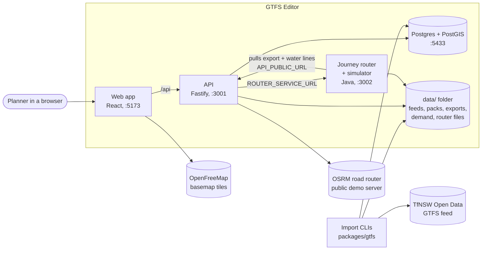
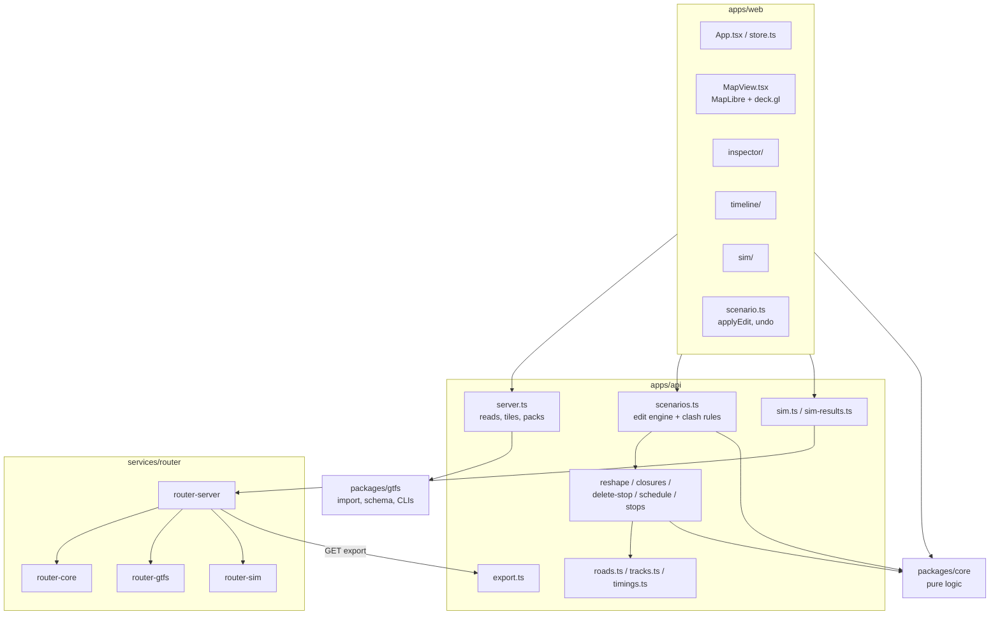
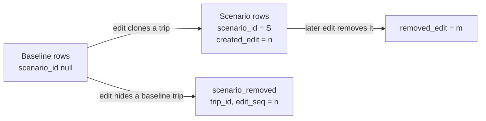
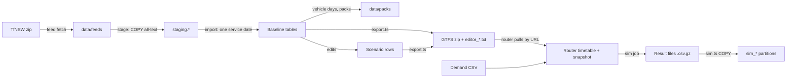

# System architecture: GTFS Editor

| | |
|---|---|
| Status | Draft (awaiting the owner's approval) |
| Describes | The system as built, checked against commit `c33fbef` (22 Nov 2026) |
| Source of truth for | How the parts fit together. Plans and progress stay in `PLAN.md`, `docs/router-plan.md` and `docs/simulator-plan.md`. |
| Navigation | `docs/codebase-map.md` |

This document was first written from the code, before any BRD existed. Where the plans and the code disagree, the code is described here and the disagreement is listed in section 11. Since then: BRDs live in `docs/brd/`, with one feature architecture document each in `docs/architecture/` (the first is `trustworthy-edits.md`), and the glossary is `docs/glossary.md`.

## 1. Purpose, scope and users

A visual editor for NSW public transport timetables (GTFS, the standard file format for timetables), with a passenger simulator. A user picks one service day of the published TfNSW timetable and does the following:

- Watches the vehicles move on a map.
- Inspects lines, trips, vehicles and stations, with timeline charts.
- Makes **scenarios**: copies of the day with changes. A change can retime trips, change frequencies, draw or reshape lines, add or delete stops, close a road or a line, or change vehicles and platforms. Every change can be undone.
- Sees **clashes** (impossible or doubtful results) with one-click fixes.
- Exports a scenario as a GTFS zip.
- Runs the **simulator**: sends a file of journeys (demand) through the published day or a scenario and compares the results.

Users: today, one owner and developer, on one Windows machine. There are no logins. The aim is a hosted service on AWS (not built).

Out of scope as built: road routing of its own (an outside OSRM server is used), journey planning in the web page, deployment, and authentication.

## 2. Architectural drivers

- **Size of the data.** A weekday is about 59,000 trips. Whole-day vehicle animation is about 53 MB per weekday, sent to the browser as binary packs. Edits must stay interactive on tables this size.
- **Every edit can be undone and has no side effects on other scenarios.** This drives the copy-on-write scenario model (section 5.3).
- **Honest results.** The clash rules and the simulator's "honesty" outputs (made-up journeys labelled, people who gave up counted) aim to show only what the data supports.
- **Speed of the journey router.** A median of 8 ms for a single query, and bulk assignment of up to millions of journeys. This is why the router is a separate Java service with flat in-memory arrays.
- **A small machine.** The dev machine is low on memory. The Gradle daemon is limited to 512 MB, the router heap to 768 MB, and the Docker router to 1 GB.
- **One developer.** Simple tooling: no build step for Node, no queues, no ORM.

## 3. System context

| Outside system | Used by | How | Notes |
|---|---|---|---|
| TfNSW Open Data GTFS | `packages/gtfs/src/feed/feed-cache.ts` | HTTPS, `API_KEY` | Downloaded once per feed version, checked by etag |
| OSRM (`ROUTER_URL`) | `apps/api/src/routing/roads.ts` | `route`, `table`, `nearest` | Currently the public demo server, so stop coordinates leave the machine. It cannot be told a road is closed. At most two requests at a time. |
| OpenFreeMap | `apps/web/src/app/theme.ts` | Style URLs | Basemap only |

## 4. Components

| Part | Responsibility | Must not |
|---|---|---|
| `apps/web` | Everything the user sees. It holds one zustand store. Vehicle animation, the clock and simulator loads are kept outside React for speed. Every change goes through `scenario.ts` `applyEdit`. | Decide whether an edit is valid, or work out clashes (both are done on the server). |
| `apps/api` | The HTTP API, the scenario edit engine, the clash rules, map tiles, export, and the simulator back end that drives the router and keeps its results. | Import feeds (that is a CLI). |
| `packages/core` | Logic with no database or IO: vehicle-day chaining, the pack format, reshape geometry and timing, the delete-stop rule, waits, physical limits, time formatting. Unit-tested. | Depend on anything. |
| `packages/gtfs` | Download, staging and import of a feed into a baseline; the database schema as numbered migrations (`sql/migrations/`); pack building; the audit and export-check CLIs. | Serve HTTP. |
| `services/router` | A Java RAPTOR journey router (an algorithm for public transport journey planning) and the passenger simulator, behind an HTTP service. It loads timetables from the editor's GTFS export. | Read the editor's database. It only sees exported zips. |

The router's own modules are `router-core`, `router-gtfs`, `router-sim`, `router-server`, `router-road` (an empty placeholder) and `router-bench` (a placeholder). They are described in `services/router/README.md` and `docs/router-plan.md`.

## 5. Information architecture

### 5.1 Key entities

| Entity | Meaning | Stored in | Owner (who writes) |
|---|---|---|---|
| Feed | One downloaded TfNSW GTFS version | `data/feeds/`, `staging.*` | Import CLIs |
| Baseline | One **service date** of one feed, `unique(feed_id, service_date)`, with `day_type` | `baselines` | Importer only |
| Mode | Train, metro, light rail, ferry, bus, coach, school bus, with a rule set of rail, ferry or road | `modes`, `route_type_modes` | Schema seed |
| Route (line), Pattern (stopping pattern), Trip, Stop time, Stop (station, platform, stop), Shape | GTFS data for the day | `routes`, `patterns`, `trips`, `stop_times`, `stops`, `shapes` | Importer; scenarios add rows |
| Vehicle day | Trips chained into one vehicle's day, from the feed's run numbers or inferred | `vehicle_days`, `trips.vehicle_day_id` | Importer (`core/vehicle-days.ts`); scenarios add or change |
| Stay-aboard link | Passengers stay on through two trips of the same block | `stay_aboard_links` | Importer |
| Vehicle type | Capacity (seated and standing), with a placeholder flag and fleet size | `vehicle_types`, `mode_default_vehicle`, view `trip_vehicle` | Seed, import (train sets), user (Fleet screen) |
| Scenario | A baseline plus edits, with a `head` (the edit it is at) | `scenarios`, `scenario_edits` | API edit engine |
| Edit | One change: one of 19 kinds (shift, reshape, close, deleteStop, and so on) | `scenario_edits` (kind and summary only) and the rows it created or removed | API edit engine |
| Clash (conflict) | A doubtful result: platform, vehicle, speed, place, closure | Worked out on request, not stored. Clashes already in the feed are in `baseline_conflicts`. | `scenarios.ts` `conflictsIn` |
| Closure | An area or part of a line closed for some or all of the day | `scenario_closures` | `closures.ts` |
| Pack | Binary whole-day vehicle positions for one mode | `data/packs/<baseline>/<mode>.bin` | Importer (`import/packs.ts`) |
| Demand set | A CSV of journeys (`user_id`, `start_time`, `origin_stop`, `destination_stop`, …) | `demand_sets` plus `data/sim/demand/` | User uploads or made up by the router |
| Sim run | One simulator run: kind BAU (business as usual), scenario or capacity | `sim_runs`; results in the partitions `sim_journeys`, `sim_legs`, `sim_trip_loads`, `sim_stop_activity`; `sim_link_loads` | `sim.ts`, `sim-results.ts` |
| Timetable (router) | An exported day loaded into the router's memory under a named id, with a binary snapshot | Router memory, `data/router/snapshots/` | Router |
| Load state (router) | Passengers aboard per stop time, in memory, at most 8 per timetable | Router memory | Router |

The terms above follow `docs/glossary.md` (started 23 Nov 2026), which is the place to look for what each one means.

### 5.2 Times and identifiers

- Times are **seconds from the start of the service day** and can pass 24:00. This is used everywhere: database, packs, router and demand files.
- Database ids are integers per baseline. GTFS ids are kept as text. Scenario rows get new ids, and edits answer with an `idMap` so the browser can follow them.

### 5.3 How scenarios store changes (copy-on-write)

- A row is **visible** in scenario S at head h if it is a baseline row not hidden by an edit at or before h, or a row of S with `created_edit <= h` that has not been removed by h. This is `visible()` in `apps/api/src/scenarios/scenarios.ts`.
- **Undo and redo move `head`.** A new edit after an undo deletes every row with `created_edit > head`, so the redo history is gone.
- **An edit changes only rows it made itself**, apart from the tag that removes an earlier row (`removed_edit`, or a `scenario_removed` row). An edit that needs to change an earlier row copies it first. The change list (D11) depends on this; see I7.
- Each edit runs in one transaction with `FOR UPDATE` on the scenario. An edit naming a trip that has since been replaced gets **409**. An edit that would add ten or more vehicles is rolled back and answers `needsConfirm`, and the browser resends it with `confirm: true`.
- **The stored rows are the source of truth.** `scenario_edits` keeps only each edit's kind and summary, so edits cannot be replayed. Rebasing a scenario onto a new feed is future work that will need its own design (decision D3).

### 5.4 Data flow and lifecycle

- **Feeds** stay in `data/feeds/` until deleted by hand.
- **Baselines** live until the same date is imported again. That **deletes the baseline and, by cascade, every scenario on it**, so the importer refuses a day with scenarios unless given `--replace` (I1, resolved).
- **Sim results** are kept per run. Archiving a run drops its journey and leg partitions.
- **The router's own zips and snapshots** are pruned when a newer version replaces them. Snapshots of zips loaded by path are never removed.
- **The whole `data/` folder** is gitignored and about 4 GB.

## 6. Interfaces

| Interface | Where defined | Notes |
|---|---|---|
| Editor HTTP API, `/api/*` | `apps/api/src/*.ts` (`register*Routes`) | About 90 routes. Almost every read takes `?s=<scenarioId>`. All changes go through `POST /api/scenarios/:id/edits`. The full list is in `docs/codebase-map.md`. |
| Map tiles | `GET /api/baselines/:b/tiles/:z/:x/:y` | Mapbox vector tiles from `map_lines` and `stops`, for the **baseline only**. What a scenario adds is drawn from GeoJSON routes. |
| Packs and waits | `GET /api/baselines/:b/packs/:mode`, `/waits` | Binary. Format in `packages/core/src/pack.ts`. |
| GTFS export | `GET /api/baselines/:b/export?s=&shapes=0&box=` | Standard GTFS plus `editor_vehicle_types.txt` and `editor_trip_vehicles.txt` |
| Router HTTP API, `/v1/*` | `services/router/router-server/.../RouterServer.java` | Timetables, journeys (single and bulk NDJSON), load states, demand check and generation, simulations. See `services/router/README.md`. |
| Demand file | `services/router/README.md`, simulator-plan §3.1 | CSV, gzip allowed |

## 7. Technology

- **Node ≥ 24.** TypeScript 7 is run directly with Node's type stripping. There is no build for the API or the CLIs, so imports use `.ts` extensions and only erasable syntax.
- **Web:** React 19, Vite 8, MapLibre GL, deck.gl 9, zustand, and hand-drawn canvas timelines.
- **API:** Fastify 5, postgres.js (no ORM; SQL in template strings), yazl, @fastify/compress.
- **Import:** postgres `COPY`, yauzl. DuckDB is used only for the audit and export-check.
- **Database:** PostgreSQL 17 with PostGIS 3.5, in Docker.
- **Router:** Java 25, Gradle 9 (Kotlin DSL), Javalin 7, Jackson, JUnit 6, compiled with `-Werror`.
- **Tooling:** npm workspaces, vitest, oxlint, Prettier. There is no CI.

## 8. Cross-cutting concerns

- **Security and privacy:**
  - There is no authentication and no CORS setting.
  - The API listens on `0.0.0.0`, and demand uploads have no size limit.
  - Stop coordinates are sent to the public OSRM server.
  - This is acceptable for one person on one machine, and not for hosting (risk R1).
- **Errors:**
  - Each module throws `Error` with a `statusCode` through a local `fail()` helper. Fastify turns it into JSON, and there is no global handler.
  - 400 means bad input and 404 means not found.
  - 409 means a stale edit, a trip that would run backwards, or a sim run in the wrong state.
  - 503 means the router is down.
  - The router answers `{"error": …}`.
- **Logging:** Fastify's logger at `warn`, and a few `log.error` calls. The router uses slf4j-simple.
- **Configuration:** environment variables only, from `.env` at the repo root, plus the router's own `ROUTER_*` settings. `ROUTER_URL` is OSRM; `ROUTER_SERVICE_URL` is the Java router. The list is in `docs/codebase-map.md`.
- **Validity (clash) rules:** SQL on the server only (`scenarios.ts` `conflictsIn`), using the limits in `packages/core/src/limits.ts`. Each list is capped (200, 60 and 2000). Guards against impossible edits live in each edit module.
- **Long-running work:**
  - Sim runs are in-process promises in the API (`drive()`), resumed when it starts. The router runs one simulation at a time in a queue.
  - Export streams through temporary staging tables.
  - The dev API restarts on any source change, which cuts off an export in progress.

## 9. Deployment and environments

- **Development only.** `docker compose up -d db` starts Postgres on port 5433. `npm run dev` starts the API (`node --watch`) and the web app (Vite). `npm run router:dev` starts the router with Gradle.
- `docker-compose.yml` also has a `router` service behind the `router` profile. Its image has not been rebuilt since the endpoints were added.
- There are no other environments and no CI. AWS, a self-hosted routing server and logins are planned (PLAN.md, remaining work item 6).

## 10. Decision log

| # | Date | Decision | Options considered | Reason |
|---|---|---|---|---|
| D1 | before Nov 2026 (PLAN.md) | Scenarios are copy-on-write rows with a `head` pointer | An edit log replayed on read; copied rows | Fast reads on large tables; undo is a pointer move |
| D2 | before Nov 2026 (PLAN.md) | Clash rules run on the server only | Shared with the browser in `packages/core`; server only | One source of truth; the rules need the database. PLAN.md:46 records the change. |
| D3 | 22 Nov 2026 | The copied rows are the source of truth. Edits are not stored in a form that can be replayed, and rebasing onto a new feed is future work. | Store each edit's parameters now; accept as built | Owner accepted as built |
| D4 | Nov 2026 (router-plan) | The journey router is a separate Java service that reads the editor's GTFS export | In Node; a separate service | Speed targets; a clean boundary (the router never reads the database) |
| D5 | before Nov 2026 | Road paths come from an outside OSRM server | Valhalla with OSM in the database (the original plan); OSRM API | Nothing to host yet. A routing server of our own is still planned. |
| D6 | 22 Nov 2026 | The vehicle catalogue ships with placeholders, and real NSW vehicle types remain the aim | Placeholders as the design; placeholders for now | Owner: the placeholders are as built and the aim stands |
| D7 | 22 Nov 2026 | Lint with oxlint, not ESLint | ESLint with typescript-eslint; oxlint; Biome | typescript-eslint does not support TypeScript 7 |
| D8 | 23 Nov 2026 | Organise code by feature folders: one folder per part of the product, plus `shared/`, with the conventions in `CLAUDE.md` and `docs/codebase-map.md` | By kind (`components/`, `hooks/`, `routes/`…); by feature | What changes together lives together, and it matches how `sim/`, `timeline/` and `inspector/` already work. By kind spreads one feature over five folders. Moved to in stages (`docs/refactor-plan.md` stage 2). |
| D9 | 23 Nov 2026 | Web and API share request and response types written once in `packages/core/src/api/` (A), with a schema library (B) for request bodies later | A: shared types; B: a schema library (such as Zod); C: a client generated from the API | A needs no new library and no build step. B, checking request bodies when the app runs, can be added route by route before hosting. |
| D10 | 23 Nov 2026 | Refactor stages 3 (split `scenarios.ts`) and 6 (numbered migrations) are done before the work in BRD `trustworthy-edits` | Split first; fixes first then split; build into today's files | That work lands almost entirely in `scenarios.ts`, and it needs schema changes. Details: `docs/architecture/trustworthy-edits.md` §1. |
| D11 | 23 Nov 2026 | An edit's change list is worked out on read from the rows the edit tagged (`created_edit`, `removed_edit`, `scenario_removed.edit_seq`, `cloned_from`). Only the reasons for estimates are stored (`scenario_edit_notes`). | Worked out on read; a full record at apply time; each edit kind writing its own | Covers every edit kind at once, adds almost no time to edits and stores no copy of the timetable. It depends on the rule in 5.3 that an edit changes only rows it made. |
| D12 | 23 Nov 2026 | `import --replace` runs as one database transaction; packs are written after the commit | One transaction; build beside the old day and swap | The smallest change, and Postgres keeps showing the old day to readers until the commit |
| D13 | 23 Nov 2026 | Coding standards gaps become tickets; all new code meets the standards in section 14 now | Tickets with strict new code; record only; fix all first | Fixes land without a week's delay, and the gaps stop growing |

## 11. Issues and discrepancies

### Open

| # | Found | Where | Who acts |
|---|---|---|---|
| I6 | Coding standards gaps (section 14): no check for unused variables or parameters; 20 uses of `any` and 32 `as never` casts; 28 files over 300 lines and no file length check. Decided by D13. | `tsconfig.base.json`, `.oxlintrc.json`, `apps/*/src`, `packages/*/src` | Project manager (tickets) |
| I7 | The copy-on-write rule "an edit changes only rows it made, apart from the tag that removes an earlier row" holds in the code sampled but is not enforced or written down in the code. D11 depends on it. | `apps/api/src/scenarios/` | Developer (a check for every edit kind, BRD `trustworthy-edits` step 3) |

### Resolved: fixed in the code

| # | Found | Fixed | The fix |
|---|---|---|---|
| I2 | The file header said "nothing is written", but `buildLinkLoads` deletes from and inserts into `sim_link_loads`. | 23 Nov 2026 | The header of `apps/api/src/sim/results-read.ts` now says the file reads results and also writes the link loads. |
| I3 | Undo and redo did not check `editBusy`, so Ctrl+Z during an edit in flight was not refused. | 23 Nov 2026 | `step` in `apps/web/src/scenarios/scenario-client.ts` returns at once while `editBusy` is set, as `applyEdit` does, so the button and the keys send nothing until the edit lands. |
| I4 | Two strings said vehicle types are picked "while editing a scenario". | 23 Nov 2026 | `TripEditTools.tsx` and `FleetPanel.tsx` now say the pickers are there whenever a day is open, and the first change starts a scenario. |
| I1 | Re-importing a service date deleted that baseline and all its scenarios by cascade, with no warning. | 23 Nov 2026 | The importer refuses a day that has scenarios unless given `--replace`, and says how many it would delete. `npm run db:backup` and `db:restore` back up and restore the whole database. The cascade itself stays. |
| I5 | The importer wrote packs to `data/packs` relative to the working directory and ignored `PACKS_DIR`, which the API reads. | 23 Nov 2026 | `packsDir` in `packages/gtfs/src/import/packs.ts` now uses `PACKS_DIR`, otherwise the repo's `data/packs` found from the file's own location, as `server.ts` does. |

### Resolved: the docs are stale and the code is right (owner, 22 Nov 2026)

Each line below should be corrected in its document when that document is next edited.

| Doc line | Says | The code |
|---|---|---|
| PLAN.md:87, 95, 98 | Validity rules are shared with the browser and run in both places | Server only (`scenarios.ts` `conflictsIn`) |
| PLAN.md:96, 98 | `packages/gtfs` does import and export; the server does import | Export is `apps/api/src/export/routes.ts`; import is a CLI |
| PLAN.md:98 | The browser loads only what is on screen | Every mode's whole-day pack is loaded at start (`apps/web/src/app/App.tsx` (pack loading)) |
| PLAN.md:110, 139 | Import builds the network graph and run times per link | `tracks.ts` builds the graph in memory when first needed; `timings.ts` works out run times at edit time |
| PLAN.md:121-122 | OSM in the database; Valhalla | An outside OSRM server (`roads.ts`) |
| PLAN.md:135 | The edit log allows rebasing | Kind and summary only (D3) |
| PLAN.md:137 | Vehicle days include empty repositioning runs | Only `gap_count`; no deadhead rows |
| PLAN.md:147 | The catalogue ships with NSW defaults | Seven `DEFAULT-*` placeholders plus train types made at import (D6) |
| PLAN.md:30 | Five modules; "Phases 0 and 1 are built"; "the editor does not call it yet" | Six modules; phases 0 to 4 are built; `apps/api/src/sim/sim.ts` calls the router |
| PLAN.md:9; `router-bench/build.gradle.kts:1-2` | The demand generator is next (phase 5) | Built: `router-sim/.../DemandGenerator.java` |
| PLAN.md:46 | Dragging exists only on the trip diagram | All three charts drag (`PlatformView.tsx`, `VehicleView.tsx`) |
| PLAN.md:334, 348 | "Draw a new line" is in the left panel; the "Close a road or a line" button is on the map | Rail buttons "Draw a line" and "Close a road" (`LeftRail.tsx`) |
| `services/router/README.md:10` | "The editor does not call the service yet" | It does (simulator) |
| `services/router/README.md:364` | The "S1" label is missing | Typo |
| `docs/router-plan.md:3` | The website's use of the router is not built | True only for journey planning (phase 7) |
| `docs/router-plan.md:198-200` | Walking links: 400 m, 1.2 m/s, cap of 40 | 500 m, 1.03 m/s, cap of 150 (`TransferSettings.java:50`); §18 already says so |
| `docs/router-plan.md:380` | `route(query, CapacityMode, loads)` | `route(Query, Preferences, Capacity)` (`Router.java:139`) |
| `docs/simulator-plan.md:3, 442` | Only the first two steps of §18 are built | All five tabs and the map layers are built (lines 684, 773) |

## 12. Risks, open questions and future direction

| # | Risk | Effect | Mitigation |
|---|---|---|---|
| R1 | No authentication, an open bind, no upload limit, and coordinates sent to a public server | Fine locally; unsafe once hosted | Must be designed before any deployment (logins, a routing server of our own) |
| R2 | Re-import cascades and deletes scenarios (I1) | Loss of work | Mitigated: the importer refuses without `--replace`, and `npm run db:backup` takes a whole-database backup first |
| R3 | Edits cannot be replayed (D3) | A new feed means scenarios cannot be carried over | Design rebasing when it is needed |
| R4 | The biggest files carry many concerns: `scenarios.ts` (edit engine, eleven edit kinds and the clash rules), `MapView.tsx` (about 2,000 lines) and `styles.css` (about 3,000 lines) | Changes are slow to review and easy to break | See the suggestions given with this document |
| R5 | The browser downloads all packs (about 53 MB for a weekday) | Slow first load on a poor connection | Load only the modes shown, or load packs by area (PLAN.md lists shrinking the vehicle data) |
| R6 | Sim jobs are in-process promises in the dev API, which restarts on every save | Runs are cut off while code is being edited. They resume at start, but the work is redone. | Run the API without `--watch` for long runs, or move jobs into the router queue alone |
| R7 | Every vehicle capacity is a placeholder | Capacity results in the simulator are not real | Real vehicle types (D6) |
| R8 | There is no CI | Regressions are found late | A small GitHub Actions job running lint, format and unit tests |

Open questions: the 16 router-plan questions (each has a default), and the delete-stop rule awaiting your confirmation (PLAN.md).

## 13. Change log

| Date | Change | Why |
|---|---|---|
| 22 Nov 2026 | First version, written from the code as built | No architecture document existed; requested by the owner. No BRD. |
| 23 Nov 2026 | I2, I3 and I4 fixed and moved to the resolved table (ticket T-4) | Small known issues from section 11 |
| 23 Nov 2026 | Added D8 (feature folders) and D9 (shared web and API types) | Decisions taken in `docs/refactor-plan.md`; recorded here before files move (ticket T-5) |
| 23 Nov 2026 | I1 resolved; R2 mitigated | Refactor ticket T-2: import guard and backup scripts |
| 23 Nov 2026 | I5 resolved: the importer honours `PACKS_DIR`. The importer also takes a feed on disk (`FEED_PATH`), and `npm run test:e2e:fixture` runs the scenario e2e suite on a small test feed. | Ticket T-3: e2e tests without the real data or the dev servers. |
| 23 Nov 2026 | File paths updated for the feature-folder moves | Stage 2 of `docs/refactor-plan.md` (tickets T-6, T-7) |
| 23 Nov 2026 | Added D10 to D13, the copy-on-write rule in 5.3, issues I6 and I7, and section 14 (project structure and coding standards); pointed to the glossary and BRDs | Design of BRD `trustworthy-edits` v1.0 (`docs/architecture/trustworthy-edits.md`) |

## 14. Project structure and coding standards

This section is placed last so that the section numbers other documents cite stay as they are.

**Folder layout and rules.** The layout is by feature (D8). The target tree, the folder rules, the naming rules and what may import what are in `docs/codebase-map.md` ("Conventions that decide where code goes" and "Planned layout"); that is the single copy, kept current with every move. In short:
- one folder per part of the product, plus `shared/` (web) for what everything uses;
- a folder over about 10 to 15 files gets subfolders by sub-feature;
- no catch-all `utils`, `helpers`, `misc` or `common` folders;
- tests beside the file (`name.test.ts`), end-to-end tests in each package's `test/`;
- scripts are npm scripts that point at `packages/gtfs/src/cli/` or a package's `test/`, not loose files at the root.

**Where new things go.**

| If you are adding… | Put it in… |
|---|---|
| Logic with no database or IO | `packages/core/src/<area>/`, with a `.test.ts` beside it |
| A type shared by the web app and the API | `packages/core/src/api/` (D9) |
| An edit kind | `apps/api/src/scenarios/edits/<kind>.ts` and one line in the registry (after stage 3) |
| A clash rule | `apps/api/src/scenarios/clashes.ts` |
| An API route | the `routes.ts` of its feature folder under `apps/api/src/` |
| A schema change | a new numbered file in `packages/gtfs/sql/migrations/` (`NNNN_<what>.sql`, the next free number); never edit a merged one |
| A panel or component | its feature folder in `apps/web/src/`, with its CSS beside it |
| A map layer | a hook `apps/web/src/map/use-<thing>-layers.ts` called from `MapView.tsx` |
| A CLI | `packages/gtfs/src/cli/`, with an npm script |

**The four standards.** Use whichever is stricter of these and the project's own rules.
1. **Folders by purpose**, as above. Checked by review against `docs/codebase-map.md`; there is no automatic check.
2. **Short files.** Aim for under about 200 lines; over 300 is too long and is split by responsibility. Exempt: migrations, generated files, lock files and large fixture data. Not enforced yet: there are 28 files over 300 lines (I6), shrinking under refactor stages 3 and 5.
3. **Strong typing, no `any`.** TypeScript `strict` is on (`tsconfig.base.json`), and `tsconfig.node.json` also rejects imports Node can't run. `any`, `as never` and unexplained casts are not allowed in new code, and request bodies get real types (D9). Not enforced yet: 20 uses of `any` and 32 `as never` (I6). Java compiles with `-Xlint:all -Werror`.
4. **No unused code.** No unused imports, variables, parameters, functions, files or dependencies, and no commented-out code. Not enforced yet: `noUnusedLocals` and `noUnusedParameters` are off, and oxlint runs only its correctness rules (I6).

**Commands that check them:** `npm run typecheck`, `npm run lint`, `npm run format:check`, and `/verify` before each commit. Per D13, the tickets for I6 add `noUnusedLocals`, `noUnusedParameters`, oxlint's `no-explicit-any` and a file length check to these.
