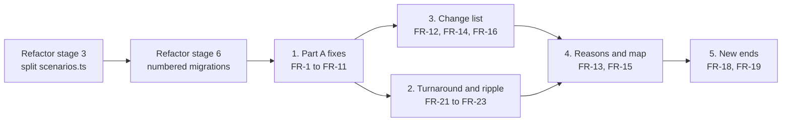

# Architecture: Edits you can trust and check

| | |
|---|---|
| BRD | `docs/brd/trustworthy-edits.md`, **version 1.1** (Approved, 23 Nov 2026) |
| Status | **Approved** (owner, 23 Nov 2026) |
| Date | 23 Nov 2026 |
| Checked against | commit `38572f2` (branch `refactor/stage-2`) |
| System architecture | `docs/architecture/system.md` (decisions D10 to D13 come from this document) |

This document says how the BRD's requirements fit the application: what goes where, what is stored, and in what order it is built. It describes design, not code. The words used are the glossary's (`docs/glossary.md`).

## 1. Decisions

The owner chose all four on 23 Nov 2026. They are recorded in the system decision log as D10 to D13.

| # | Question | Options considered | Chosen | Why |
|---|---|---|---|---|
| D10 | When to split `scenarios.ts` | Split first (refactor stages 3 and 6), then build; land the fixes first and split after; build into today's files | **Split first** | Almost every requirement changes `scenarios.ts` (2,150 lines). Building into the split files avoids moving new code twice, and the change list hooks into `engine.ts`. Stage 6 (numbered migrations) must come before the schema changes here anyway. Cost: the fixes land about a week later. |
| D11 | How the change list is recorded | Worked out on read from the rows each edit already tags, with only reasons stored; a full record written at apply time; each edit kind writing its own | **Worked out on read** | Every edit already tags what it adds (`created_edit`), what it removes (`removed_edit`, `scenario_removed.edit_seq`), and where each copy came from (`cloned_from`). So one comparison covers all 19 edit kinds at once. It adds almost nothing to the time an edit takes (NFR-2), stores no copy of the timetable (NFR-3), and handles undo and redo for free. It depends on edits never changing rows made by an earlier edit, so that rule gets a test (section 3.1). |
| D12 | Making `import --replace` safe | One transaction; build beside the old day, then swap | **One transaction** | The smallest change. Postgres keeps showing the old day to everyone else until the transaction commits, so the editor can still read it while the import runs; only edits to that day's scenarios wait. Packs are written after the commit. |
| D13 | Gaps against the coding standards | Tickets, with strict rules for new code; record only; fix everything first | **Tickets, with strict rules for new code** | Turn on unused-code checks and a "no `any`" rule now, and ticket the existing cases. Everything this work adds meets the standards: files under 300 lines, no `any`, no unexplained casts. |

Smaller choices made in this document, which the owner can reopen:

- **New ends are judged by station for trains, metro, light rail and ferries, and by stop for buses and coaches.** A train ending at platform 2 where trains already end at platform 1 is not a new end.
- **The minimum turnaround is also used when the editor assigns vehicles in a scenario.** Otherwise a raised setting would make the editor's own vehicle chains clash at once. This goes slightly beyond FR-23, so it is raised as issue AI-4.
- **New types shared by the web app and the API go in `packages/core/src/api/`** now, as D9 intends, even though stage 4 has not moved the existing ones yet.

## 2. Order of work



- Stage 3 and stage 6 are already planned in `docs/refactor-plan.md`, and their rule still applies: nothing the user can see changes.
- Each step after that is its own set of tickets, and each ticket starts with a failing test.
- Steps 2 and 3 can run side by side.
- FR-8 (re-import) and FR-11 (midnight) touch none of the split files, so they can start as soon as stage 6 is done, or even before it.

## 3. Design

### 3.1 The change list (FR-12, FR-14, FR-16)

**How a change is found.** For an edit numbered *n* in scenario *S*, everything comes from rows that already exist:

| What | Where it comes from |
|---|---|
| Trips taken away | published trips in `scenario_removed` with `edit_seq = n`, plus scenario trips with `removed_edit = n` |
| Trips put in | scenario trips with `created_edit = n` |
| Changed trip | a trip put in whose `cloned_from` is a trip taken away by the same edit. One old trip with two new ones is a **split** (closures). |
| Added trip | a trip put in with no `cloned_from`, or one copied from a trip that stays (a copy, a frequency change) |
| Removed trip | a trip taken away that nothing put in replaces |
| Lines, stops, vehicles, closures added or deleted | `created_edit = n` on `routes`, `stops`, `vehicle_days`, `scenario_closures`, `scenario_removed_stops` |

Comparing one trip's old and new calls (stops added and dropped, times moved, platform changes, vehicle changes) is pure logic. It lives in `packages/core`.

**The rule it depends on: an edit changes only rows it made itself.** The one exception is the tag that removes an earlier row. The code samples checked follow this rule: in-place updates in `delete-stop.ts` and `schedule.ts` touch only the copies the same edit made. But nothing enforces it. Step 3 adds an end-to-end check that runs every edit kind and confirms that no row made by an earlier edit has changed, apart from its removal tag. If an edit kind breaks the rule, it is fixed to copy first.

**Undo and redo.** An edit after the head is not shown (A6). Its rows stay until a new edit discards the redo history, so redoing it shows its change list again, with no extra work.

**Older edits.** Their rows are tagged in the same way, so their trip-by-trip list can be worked out too. Only the reasons are missing. This is better than FR-16 asks; see issue AI-3.

**Speed.** One edit touches at most a few thousand trips; the Harbour Bridge closure touches 2,974. The read uses indexes on `trips (scenario_id, created_edit)`, `trips (scenario_id, removed_edit)` and `trips (cloned_from)`, which are added in the migration. The trip list comes a page at a time, and the calls of one trip are read only when it is opened.

**API.**

| Route | Returns |
|---|---|
| `GET /api/scenarios/:id/edits/:seq/changes` | Header counts (trips added, removed, changed and split; vehicles before and after; estimates; new ends) and one row per line |
| `GET /api/scenarios/:id/edits/:seq/changes/trips?route=&page=` | Trips of one line in that edit: kind of change, old and new first departure, vehicle before and after, number of estimates |
| `GET /api/scenarios/:id/edits/:seq/changes/trips/:tripId` | One trip's calls old against new, with its reasons |
| `GET /api/scenarios/:id/edits/:seq/changes/map` | GeoJSON for the map view (FR-15): changed lines, added and deleted stops, new ends |

These are reads, so they don't break the rule that only `POST /edits` writes timetable rows.

### 3.2 Reasons and estimates (FR-13)

Reasons are the one thing a later read cannot work out, so they are stored.

- **Table `scenario_edit_notes`:** the scenario, the edit number, and optionally a trip, a stop sequence and a line. Each row has a `code` and a small `detail` (JSON). It is deleted with its scenario. When a new edit discards the redo history, the engine deletes notes with `edit_seq > head`, next to the rows it already deletes.
- **One list of codes**, a typed union in `packages/core/src/changes/reasons.ts`:

| Group | Codes |
|---|---|
| Run time | `published` (with how many trips), `nearby` (how many), `modeSpeed`, `detourScaled` (the length ratio), `detourModeSpeed` |
| Platform | `kept`, `free`, `leastBusy` |
| Vehicle | `kept`, `existingFree`, `new` |
| Detour | `routed`, `noneFound` |
| Template trip | `copiedFrom` (the trip id, and whether it was edited) |
| End of line | `newEnd` (the stop or station) |

  The web app reads the same type to word and mark each estimate. A single list means a later "check this scenario" button or a download can reuse the data.
- **How notes are written.** The engine gives each edit an **edit context**: the transaction, the scenario, the edit number, and a note buffer. The helpers that make estimates return where each estimate came from, as `sectionTime` already returns `source`. The edit kind that called them adds a note for the trip it applies the estimate to. At the end of the edit, the engine writes the whole buffer in one insert, so a big closure costs one statement and not thousands (NFR-2).

| Helper | Gives back |
|---|---|
| `routing/timings.ts` `sectionTime` | run time source (already does) |
| `routing/roads.ts` `routedAround` | `routed` or `noneFound` |
| `settlePlatforms`, the platform choice in `delete-stop` | platform reason |
| `scenarios/vehicles.ts` `assignVehicles` | vehicle reason per trip |
| template choice (FR-1) | `copiedFrom` |
| new end check (FR-18) | `newEnd` |

### 3.3 Minimum turnaround and ripple (FR-21 to FR-23)

- **Setting.** A new column, `modes.min_turnaround_secs`. Its starting values are those in A4: 120 seconds for the rail and ferry rule sets, 60 for road. It is one setting for the whole editor, not one per scenario (A3). It is read and changed through new catalogue routes, `GET /api/modes/turnarounds` and `PUT /api/modes/:id/turnaround`. Changing it is not a scenario edit, so it cannot be undone, the same as other catalogue changes (see BRD issue I-4).
- **Soak up the delay** is a pure function in `packages/core/src/edits/ripple.ts`. It takes the vehicle's later trips (start, end), the delay and the turnaround, and gives each trip's shift. It stops at the first trip that needs none. The API's shift edit reads the vehicle's trips, calls it, and copies only the trips that move.
- **Both directions.** The line ripple picks every trip of the line that starts at or after the old start of the retimed trip, in either direction.
- **The shift edit's request** gains `rippleMode`: `soak` or `full` when `ripple` is `vehicle`, `both` or `same` when it is `line`. A request with no `rippleMode` gets the BRD's defaults, `soak` and `both`. That changes how existing callers behave; the web app is the only caller.
- **The turnaround clash** goes in `scenarios/clashes.ts`. It flags trips the scenario made or changed, as the BRD assumes in Q3. The vehicle clash's one-click fix uses the setting in place of the fixed 60 seconds.
- **Vehicle assignment in scenarios** (`assignVehicles`) uses the setting as its least layover, so new chains never break it (issue AI-4). Building vehicle days at import keeps its own values in `packages/core/src/vehicle-days.ts`: they describe the published timetable and are not changed.

### 3.4 Part A fixes (FR-1 to FR-11)

| FR | Where, after stage 3 | Design |
|---|---|---|
| FR-1 | `edits/headway.ts`, `edits/line-frequency.ts`, `edits/add-trip.ts`; `packages/core/src/edits/template.ts` | `pickTemplate` prefers a trip whose calls match its published origin, ignoring an even shift in time. The comparison is the change list's own trip comparison, so the two agree on what "edited" means. It records a `copiedFrom` note. |
| FR-2 | `packages/core/src/edits/overlap.ts`, used by `scenarios/clashes.ts` and `settlePlatforms` | One overlap test that counts touching calls (≤ in place of <). `settlePlatforms` checks the clash list again before each move. FR-24 keeps the extra clashes to trips that really changed. |
| FR-24 | `scenarios/clashes.ts`; `packages/core/src/changes/trip-diff.ts` | A trip counts as changed when it has no published origin, or when the trip comparison finds a difference from that origin (calls, times, platforms or vehicle). Doing this per trip in SQL would be slow, so `clashes.ts` keeps today's SQL to find candidates among scenario trips, then drops any clash where no trip involved has changed. Whether a trip has changed is worked out in one query per clash check: it compares each scenario trip's calls with its origin's calls. |
| FR-3 | `scenarios/engine.ts` (the confirm step) | Count the network's vehicles before and after inside the transaction. Ask when the difference is 10 or more. |
| FR-4 | `edits/duplicate.ts` | Call the same `requireLive` check the replacing edits use, and refuse trips from another scenario or day. |
| FR-5 | `routing/timings.ts` | Evidence is a published trip whose next stopping call after the first stop is the second stop (calls it passes without stopping are allowed), and whose distance between them is within 10% of the new stretch's length (from `shape_dist_traveled`). Trips with no distances are left out. |
| FR-6 | `scenarios/edits/reshape.ts` `acrossTheRoad`; `export/routes.ts` | `acrossTheRoad` filters through `stopVisible`. The export first counts calls at deleted stops and answers 409, naming the first trip and stop, before it starts writing the zip. A zip already being sent cannot report an error properly. |
| FR-7 | `packages/core/src/edits/delete-stop.ts`, used by `scenarios/edits/delete-stop.ts` | The platform is chosen for a **visit**, not a call: one vehicle's arrival and its next departure from the same platform within the hour form one visit, taking up the platform from arrival to departure. Both calls move together. |
| FR-8 | `packages/gtfs/src/import/baseline.ts`, `cli/import.ts` | `sql.begin` wraps the delete, the baseline build, vehicle days and `finish`. Each step takes the transaction in place of the shared connection. Staging (`stage.ts`) stays outside it, and packs are written after the commit. |
| FR-9 | `export/routes.ts`; `packages/gtfs/src/cli/export-check.ts` | Add an `origin_trip_id` column to `editor_trip_vehicles.txt` (the published `gtfs_id` it came from). The router reads columns by name (`GtfsLoader.java:765`), so an extra column is safe. `export-check` reads both `editor_*` files and checks that every trip and vehicle type exists. |
| FR-10 | `edits/set-vehicle-type.ts`; `scenarios/engine.ts` cloning | A line-level choice is stored as a row tagged with its edit, in `scenario_route_vehicle_types`, and follows the copy-on-write rule. New trips on that line take the type from it. The resolution order stays trip, vehicle day, line, mode. |
| FR-11 | `apps/web/src/inspector/TripEditTools.tsx`; `packages/core/src/time.ts` | `nearestShift(fromSecs, typedClock)` picks the move of under 12 hours. Unit-tested across midnight. |

### 3.5 New ends (FR-18, FR-19)

- **Published ends** for a day are the distinct `first_stop_id` and `last_stop_id` of its published trips. For trains, metro, light rail and ferries they are taken up to the station. They are worked out once per day and kept in memory, as `tracks.ts` already does for its graph. A day never changes, so nothing goes stale.
- `packages/core/src/edits/new-ends.ts` takes the new first and last stops of the trips an edit cuts short, and the published ends, and gives back each new end with its lines and trip count.
- `delete-stop` and `closure` previews return a `newEnds` list. Applying either records `newEnd` notes, so the same list appears in the change list and on the map.
- **Web.** One component, `apps/web/src/editing/NewEndsList.tsx`, sits at the top of `editing/`, so the station panel (`inspector/`) can import it under the folder rules. Both the delete-stop card and the closure panel use it.

### 3.6 Closures (FR-19, FR-20)

- FR-19 is section 3.5.
- FR-20 turned out to be mostly built already; see issue AI-1. A drawn closure already accepts "leave running" for any line, in any mode (`closure.ts:516-519`), and the panel offers it on every listed line (`ClosurePanel.tsx:545`). The gap is that the panel lists only the first 60 lines (`ClosurePanel.tsx:515`; the Harbour Bridge crosses 62). The design fix: page the list, or let the "show only lines through this place" filter reach every line.

### 3.7 Web app

| Piece | Where | Notes |
|---|---|---|
| Change list | `apps/web/src/scenarios/changes/ChangeList.tsx`, `ChangeTrip.tsx`, `changes-api.ts`, `changes.css` | Opened from an edit in the Timetable pane's change history. Pages through trips. Estimates are shown from the reason codes. |
| Map view of one edit | `apps/web/src/map/use-change-layers.ts` | A hook in the stage 5 style. MapView only calls it, so it doesn't grow. The store gets `changeView: { scenarioId, seq } \| null`. |
| Ripple choices | `apps/web/src/inspector/TripEditTools.tsx` | Two choices under each ripple option, with the BRD defaults. |
| Turnaround settings | `apps/web/src/catalogue/TurnaroundSettings.tsx` | Inside the vehicle catalogue modal. |
| New ends | `apps/web/src/editing/NewEndsList.tsx` | See 3.5. |
| Closure lines | `apps/web/src/editing/closures/ClosurePanel.tsx` | AI-1 fix. `ClosurePanel.tsx` is already long, so the line list moves into `ClosureLines.tsx` beside it. |

### 3.8 Data changes (migrations after stage 6)

| Migration | Change |
|---|---|
| `00NN_change_list.sql` | Indexes `trips (scenario_id, created_edit)`, `trips (scenario_id, removed_edit)`, `trips (cloned_from)`, `trips (baseline_id, first_stop_id)`. Table `scenario_edit_notes (scenario_id → scenarios on delete cascade, edit_seq, trip_id null, stop_seq null, route_id null, code, detail jsonb)`, indexed on `(scenario_id, edit_seq)`. |
| `00NN_turnaround.sql` | `modes.min_turnaround_secs int not null`, filled from the rule set |
| `00NN_line_vehicle_type.sql` | `scenario_route_vehicle_types (scenario_id, route_id, vehicle_type_id, created_edit, removed_edit)` |

The numbers follow whatever stage 6 and stage 4.3 (the edit body column) take first.

## 4. Files to add or change

All new files are planned to stay under 300 lines, with no `any` (D13). The paths assume stage 3 is done, as in `docs/codebase-map.md` "Planned layout".

```
packages/core/src/
  api/changes.ts                 NEW  request and response types for the change list routes (D9)
  changes/reasons.ts             NEW  the reason codes (3.2)
  changes/trip-diff.ts           NEW  compare one trip's old and new calls (3.1); + .test.ts
  edits/ripple.ts                NEW  soak up the delay (3.3); + .test.ts
  edits/template.ts              NEW  choose a template trip (FR-1); + .test.ts
  edits/overlap.ts               NEW  the one overlap test (FR-2); + .test.ts
  edits/new-ends.ts              NEW  find new ends (3.5); + .test.ts
  edits/delete-stop.ts           CHANGE  platform choice by visit (FR-7)
  time.ts                        CHANGE  nearestShift (FR-11)
packages/gtfs/
  sql/migrations/00NN_*.sql      NEW  three migrations (3.8)
  src/import/baseline.ts, src/cli/import.ts   CHANGE  one transaction (FR-8)
  src/cli/export-check.ts        CHANGE  check the editor_* files (FR-9)
apps/api/src/
  scenarios/engine.ts            CHANGE  edit context with note buffer; drop notes on redo truncation; net vehicle count
  scenarios/clashes.ts           CHANGE  overlap test, turnaround clash
  scenarios/vehicles.ts          CHANGE  turnaround as least layover; vehicle reasons
  scenarios/changes/read.ts      NEW  works out a change list from tagged rows (3.1)
  scenarios/changes/notes.ts     NEW  the note buffer and reading notes back
  scenarios/changes/routes.ts    NEW  the four GET routes
  scenarios/changes/new-ends.ts  NEW  published ends per day, kept in memory (3.5)
  scenarios/edits/*.ts           CHANGE  shift (ripple), duplicate, headway, line-frequency,
                                         add-trip, set-vehicle-type, reshape, delete-stop, closure:
                                         notes and the fixes in 3.4
  routing/timings.ts             CHANGE  evidence filter (FR-5)
  catalogue/routes.ts            CHANGE  turnaround routes
  export/routes.ts               CHANGE  deleted-stop check, origin_trip_id (FR-6, FR-9)
apps/web/src/
  scenarios/changes/             NEW  ChangeList.tsx, ChangeTrip.tsx, changes-api.ts, changes.css
  map/use-change-layers.ts       NEW
  editing/NewEndsList.tsx        NEW
  editing/closures/ClosureLines.tsx  NEW  (moved out of ClosurePanel.tsx)
  catalogue/TurnaroundSettings.tsx   NEW
  inspector/TripEditTools.tsx    CHANGE  ripple choices, midnight
  app/store.ts                   CHANGE  changeView
```

## 5. Requirements to design

| Requirement | Design |
|---|---|
| FR-1 to FR-11 | 3.4 |
| FR-12 | 3.1 (worked out on read) |
| FR-13 | 3.2 |
| FR-14 | 3.1 API, 3.7 change list |
| FR-15 | 3.1 map route, 3.7 `use-change-layers` |
| FR-16 | 3.1 "Older edits" (gives more than asked; AI-3) |
| FR-17 | Today's rule; no change. Covered by the existing e2e test and the regression run |
| FR-18, FR-19 | 3.5 |
| FR-20 | 3.6 (mostly built; AI-1) |
| FR-21, FR-22, FR-23 | 3.3 (FR-23's vehicle assignment: `assignVehicles` uses the setting) |
| FR-24 | 3.4 |
| NFR-1 | Every step runs `/verify`; the full suites run at the end of each step in section 2 |
| NFR-2 | Change list worked out on read; notes written in one insert; the reads are indexed and paged |
| NFR-3 | No copy of the timetable is stored; notes are deleted with redo truncation and by cascade |
| NFR-4 | UI words from the glossary; the reason codes are worded in one place in the web app |
| NFR-5 | All the pure rules in `packages/core` (section 4) |

## 6. Testing seams (for QA)

- **Pure functions with unit tests** in `packages/core`: `tripDiff`, `soakUp`, `pickTemplate`, `overlaps`, `newEnds`, the visit-based platform choice, and `nearestShift`.
- **The copy-on-write check** (3.1): an end-to-end step that, after each edit kind, compares every row made by earlier edits with a snapshot taken before it.
- **API contracts**: the four change-list routes, the turnaround routes, `rippleMode` on the shift edit, the `newEnds` list on the delete-stop and closure previews, and the 409 on export.
- **Fixture database**: the failed re-import test (AC-FR-8.1) runs against `gtfs_e2e`, with a fault injected part way through (for example a bad row in staging).
- **Router**: `GtfsLoaderTest` gains a file with the extra `origin_trip_id` column, to show it is ignored.

## 7. Issues and discrepancies

| # | Found | Who acts | State |
|---|---|---|---|
| AI-1 | BRD FR-20 asks that any single line can be left running in every mode, saying today only whole modes can. The code already does this for a drawn closure, in every mode (`closure.ts:516-519`, `ClosurePanel.tsx:545`). The real gap is that only the first 60 lines are listed (`ClosurePanel.tsx:515`), and the older "road" and "line" forms of the API don't take the choice. The BA's earlier reading was wrong. Should FR-20 be reworded to "every line crossed can be chosen, however many there are"? | Owner, then BA (BRD 1.1) | Resolved 23 Nov 2026: FR-20 reworded in BRD 1.1 |
| AI-2 | The clash rules flag any trip the scenario owns, not only trips it changed (`scenarios.ts:1401`, `1431`). So "work out the vehicles again" and choosing a line's vehicle type, which copy trips unchanged, turn clashes already in the feed into scenario clashes. FR-2's wider overlap test will add more of these. This is not in the BRD. Should clashes count only trips that differ from their published origin? | Owner, then BA | Resolved 23 Nov 2026: FR-24 in BRD 1.1 |
| AI-3 | With D11, older edits can show their trip-by-trip list, with only the reasons missing. FR-16 and A1 say older edits show only their summary. Should the BRD be updated to say older edits show their trips without reasons? | Owner, then BA | Resolved 23 Nov 2026: FR-16 changed in BRD 1.1 |
| AI-4 | The design uses the minimum turnaround when assigning vehicles in a scenario (3.3), which FR-23 does not list. Without it, raising the setting makes the editor's own chains clash. Agree, and add it to FR-23? | Owner, then BA | Resolved 23 Nov 2026: added to FR-23 in BRD 1.1 |
| AI-5 | Coding standards gaps: no check for unused variables or parameters (`tsconfig.base.json`, `.oxlintrc.json`); 20 uses of `any` and 32 `as never` casts in `apps/*/src` and `packages/*/src`; 28 files over 300 lines, with no file length check. Decided by D13: tickets, with strict rules for new code. | Project manager (tickets) | Decided 23 Nov 2026 |
| AI-6 | The rule that an edit changes only rows it made is not enforced or written down in the code. D11 depends on it. | Developer (test in step 3) | Open |

## 8. Risks and open questions

| Risk | Effect | What to do |
|---|---|---|
| An edit kind breaks the copy-on-write rule | Its change list is wrong without anyone seeing | The check in section 6, run for every edit kind, before step 3 ships |
| More clashes (FR-2, FR-23, AI-2) | The clash count jumps on existing scenarios | Expected; say so in the release note in `PLAN.md`; settle AI-2 first |
| A long import transaction on a small machine | More memory and WAL use while it runs | Measure on a full weekday; if it is a problem, fall back to building beside the old day and swapping (the other D12 option) |
| Notes on big edits | The Harbour Bridge could write about 10,000 note rows | One insert per edit; measure against NFR-2 in step 4 |
| Stage 3 grows | The fixes wait longer | Stage 3's own rule: small PRs that only move code. FR-8 and FR-11 can go first (section 2). |

Open questions are carried from the BRD: Q1 (the starting turnarounds), Q2 (the 10% length match) and Q3 (whether the turnaround clash covers published trips).

## 9. Future direction

- The reason codes, the change list and its routes are the base for a "check this scenario" button, a CSV download, comparing two scenarios trip by trip, and telling the simulator which edit changed a passenger's journey. None of these is built now.
- Better vehicle planning (the next BRD) will read `modes.min_turnaround_secs` and the vehicle reasons.
- A per-station turnaround can later sit beside the per-mode one. It is not built now.

## 10. Change log

| Version | Date | Change | BRD version |
|---|---|---|---|
| 0.1 | 23 Nov 2026 | First version | 1.0 |
| 1.0 | 23 Nov 2026 | AI-1 to AI-4 resolved by the owner and written into BRD 1.1; FR-24 designed in 3.4; approved | 1.1 |
